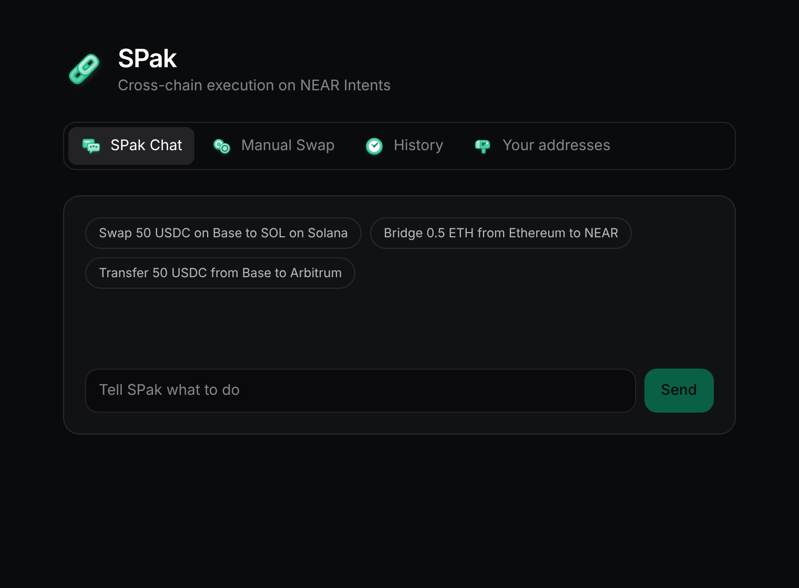
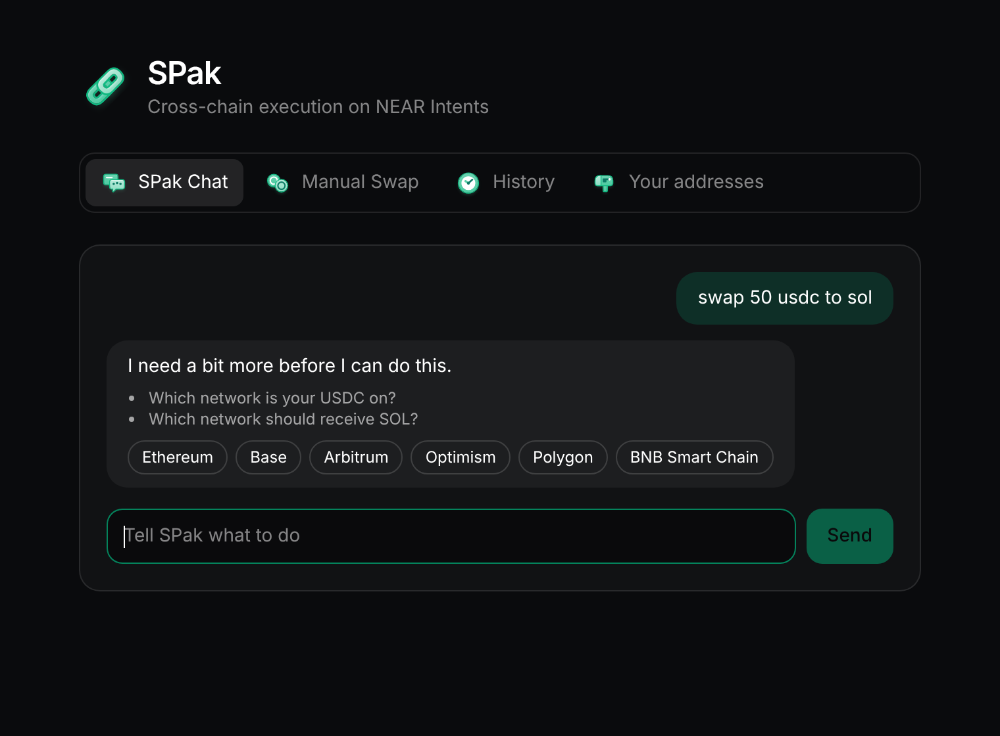
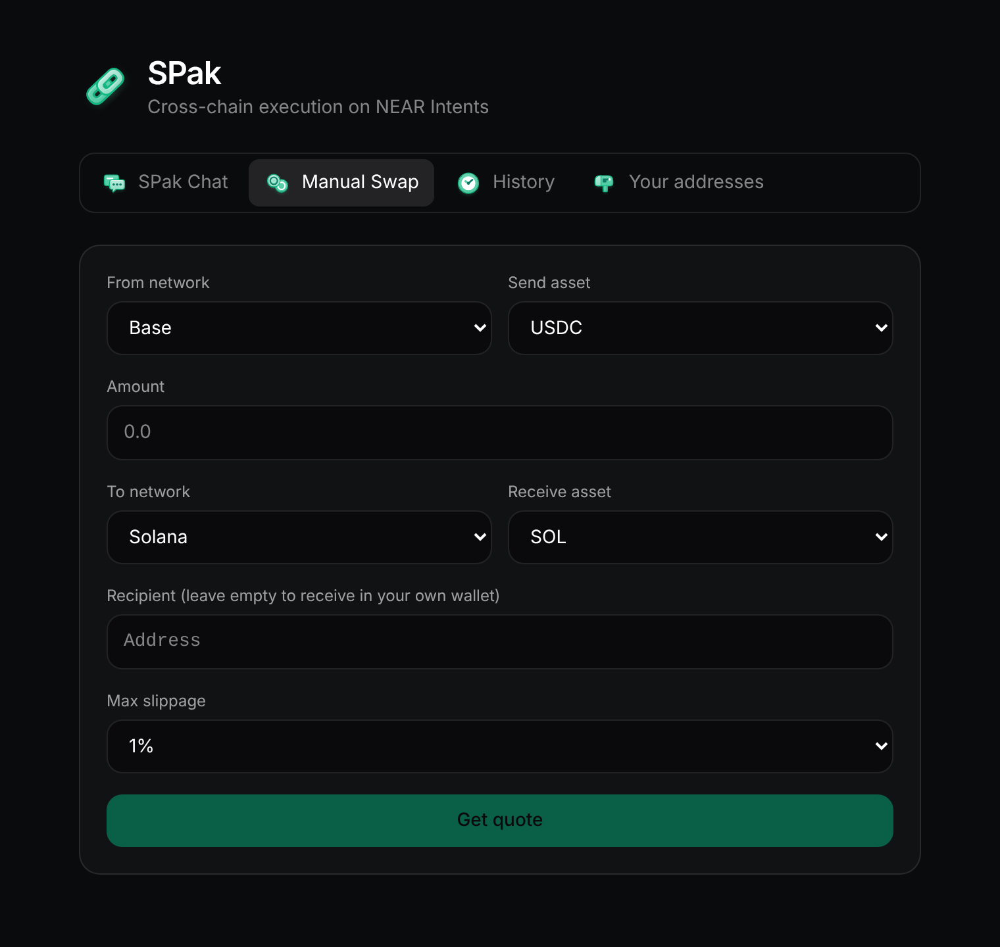
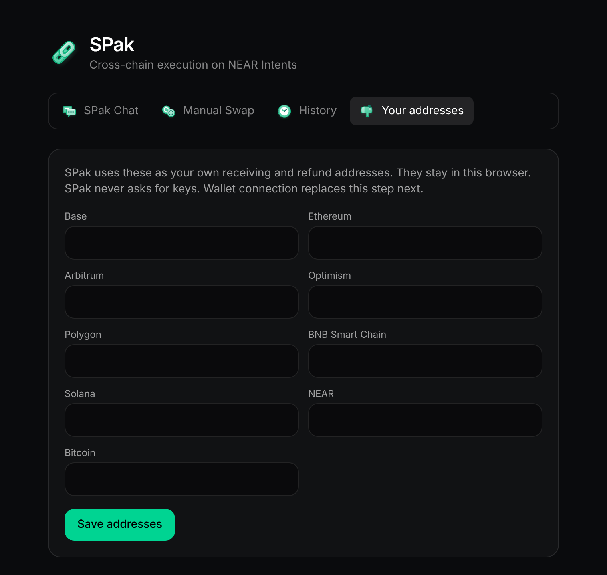
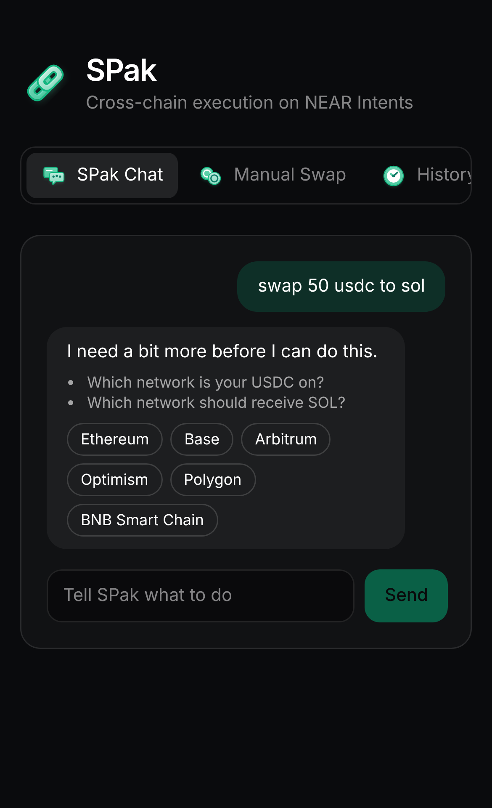
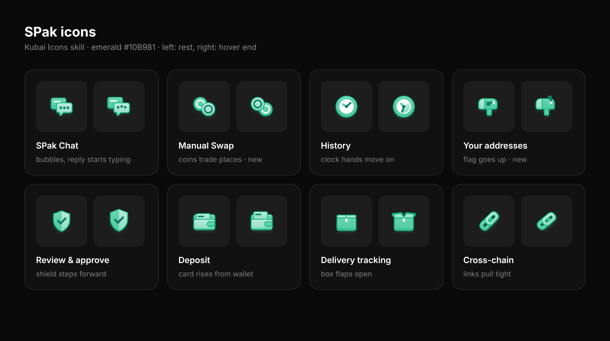

# SPak

SPak is a cross-chain execution agent built on NEAR Intents. You write what you want in plain words. SPak turns it into a checked plan, gets a firm quote, waits for your approval and tracks the transfer until delivery is verified.

> Swap 50 USDC on Base to SOL on Solana

SPak never holds your keys and never signs for you. Your wallet sends the deposit. Nothing moves without your approval.



## What problem it solves

Moving value across chains today means picking a bridge, finding the right token on the right network, copying addresses and watching several explorers. One wrong network or address can lose funds.

SPak replaces that with one instruction:

- You say what you want.
- SPak checks every field against real registries and asks when something is unclear.
- You see the exact quote and approve that exact plan.
- SPak watches the transfer and reports success only after delivery is verified.

## Example

You type `swap 50 usdc to sol`. SPak does not guess. It asks which network your USDC is on and which network should receive the SOL. Nothing is invented. No contract, address, amount or network is assumed.



## Screens

| Screen | What it does |
|---|---|
| SPak Chat | Write an instruction in plain words. SPak answers with a plan or a question |
| Manual Swap | Same checks and same approval, using a form instead of a sentence |
| History | Every submission with its status, from waiting for deposit to completed |
| Your addresses | Your own receiving and refund addresses, kept in your browser |





SPak works on a phone.



The icons are animated on hover and tab change.



## How it works

1. **You write an instruction** in chat or fill the manual form.
2. **SPak-in reads it.** This is the intent engine. It is deterministic TypeScript. It calls no LLM, holds no keys and signs nothing.
3. **SPak checks it.** Networks, assets, addresses and amounts are validated. Your SPak Guard limits are applied.
4. **SPak plans it.** The plan is hashed so it cannot change after you approve it.
5. **NEAR Intents quotes it.** You see the quote before anything happens.
6. **You approve** the exact plan. A deposit address is created only after that.
7. **You send the deposit** from your own wallet.
8. **SPak tracks it** and marks it complete only when NEAR Intents reports verified delivery.

```
text
 └─ Input Processor        normalize, reject malformed, keep numbers exact
 └─ Tokenizer              typed tokens: number, percent, money, address, word
 └─ Entity Extractor       networks, assets, schedules, triggers, slippage
 └─ Intent Parser          roles from grammar: source, destination, recipient
 └─ Intent Classifier      scored match against the intent registry
 └─ Context Resolver       apply follow-ups to the session's draft
 └─ Validation Engine      registry lookups, addresses, amounts, required fields
 └─ Policy Engine          SPak Guard: limits, allow-lists, slippage, recipients
 └─ Execution Planner      provider-neutral legs and steps, hashed
 └─ Execution Coordinator  approval check, duplicates, provider hand-off
```

Full engine reference: [docs/SPAK-IN.md](docs/SPAK-IN.md).

## What you can ask for

SPak-in understands 12 intents.

| Intent | Example | Runs today |
|---|---|---|
| Swap | `swap 100 usdc to eth on base` | Yes, with an exact amount |
| Cross-chain swap | `swap 50 usdc on base to sol on solana` | Yes, with an exact amount |
| Bridge | `bridge 0.5 eth from ethereum to near` | Yes, with an exact amount |
| Cross-chain transfer | `transfer 50 usdc from base to arbitrum` | Yes, with an exact amount |
| Payment | `send 20 usdc to 0x… on arbitrum` | Yes, with an exact amount |
| Rebalance | `rebalance to 50% eth and 50% usdc` | Understood and planned only |
| Scheduled | `every friday at 6pm transfer 25 usdc from base to arbitrum` | Understood and planned only |
| Conditional | `swap 50 usdc to eth on base when eth drops below 2000` | Understood and planned only |
| Portfolio query, status, history, cancel | `show my transaction history`, `what is my portfolio worth` | Understood only. Reading balances and past transactions is not built |

Scope today: 19 networks and 169 assets, generated from the NEAR Intents token list. SPak says "not supported" for known networks it cannot use, such as Fantom, instead of saying "unknown".

## Safety rules

These are enforced in code and covered by tests.

- SPak-in never signs, holds keys or calls a provider. The coordinator returns deposit instructions and your wallet sends them.
- A deposit address is created only after explicit approval bound to the exact plan hash.
- The coordinator accepts only plans SPak-in issued. It refuses changed plans, stale approvals and duplicates.
- Ambiguous instructions stop with a question. Nothing is guessed.
- `send` and `pay` never default to your own wallet. They need an explicit recipient.
- A refund address on the source network is required, so a failed transfer returns funds to you.
- When the USD value is unknown, limits cannot pass silently. The result is a request for your approval.
- Autonomous execution is off over HTTP.
- Success shows only after NEAR Intents reports verified delivery.
- All money math uses fixed-point integers. No floating point touches an amount.

## Accuracy

Measured by `npm run bench`. Latency is local engine time with no network.

| Set | Cases | Classification | Entity extraction | Unsafe validations |
|---|---|---|---|---|
| Main set | 219 | 99.5% | 100% | 0 |
| Held-out set | 40 | 85% | 89.7% | 0 |

The engine was tuned against the main set, so treat it as a regression suite. The held-out set was written after tuning and is the better estimate for phrasing SPak has not seen. Median time is under half a millisecond. The 95th percentile is under 2 ms. See [docs/BENCHMARK.md](docs/BENCHMARK.md) for every failure.

## Status

Built and tested:

- Intent engine, context follow-ups, validation, SPak Guard policy and execution planner
- Execution Coordinator with approval binding, duplicate prevention and audit log
- NEAR Intents provider
- Chat, manual swap, review, tracking, history and addresses screens
- Postgres storage with Drizzle, tested on PGlite. Memory storage when no database is set
- 86 automated tests

Not built yet:

- **Real-funds testing.** The NEAR Intents provider is verified with dry quotes only. No real deposit has been sent through it yet.
- **Hosted database.** Postgres is tested on PGlite and not yet on a hosted database.
- **Wallet connection.** You paste your addresses and send the deposit from your own wallet.
- **Authentication.** The API uses an anonymous browser id. Replace it before multi-user use.
- **Balance reader and price feed.** Percentage amounts, fiat amounts and rebalancing are understood and planned but not executed.
- **Scheduler and condition monitor.** Scheduled and conditional instructions are planned but not executed. The workflow in `.github/workflows/monitor.yml` calls `/api/internal/monitor`, which is not in this branch yet.
- **Stored Guard settings and NEAR account agent onboarding.**

## Stack

Next.js 15, React 19, TypeScript, Tailwind CSS 4, Zod, Drizzle ORM with Postgres, Vitest. Execution runs on the NEAR Intents 1Click API.

## Run it locally

Requirements: Node 20 or newer.

```
npm install
cp .env.example .env.local
npm run dev
```

Open http://localhost:3000. All values in `.env.example` are optional.

| Variable | Purpose |
|---|---|
| `DATABASE_URL` | Postgres for sessions, intents, submissions and the audit log. Without it, everything lives in memory and resets on restart |
| `ONECLICK_API_URL` | NEAR Intents 1Click API. Defaults to the public endpoint |
| `ONECLICK_JWT` | Partner token, server side only. Without it, quotes carry a 0.2% default fee |

With Postgres:

```
DATABASE_URL=postgres://… npm run db:migrate
```

## Commands

| Command | What it does |
|---|---|
| `npm run dev` | Start the app on port 3000 |
| `npm run build` | Production build |
| `npm test` | Unit, integration, database and benchmark regression tests |
| `npm run test:live` | Dry quote against the real NEAR Intents API. Moves no funds |
| `npm run bench` | Accuracy and latency on both benchmark sets. Add `-- --write` to update docs/BENCHMARK.md |
| `npm run typecheck` | Strict TypeScript |
| `npm run lint` | ESLint |
| `npm run registry:sync` | Rebuild the asset registry from the NEAR Intents token list |
| `npm run db:generate` | New migration after a schema change |
| `npm run db:migrate` | Apply migrations to `DATABASE_URL` |

## API

All routes live under `/api/spak-in/`.

| Route | Purpose |
|---|---|
| `POST interpret` | Read an instruction and return a validated result and plan |
| `POST manual` | Same result from the manual form |
| `POST quote` | Dry quote from NEAR Intents. Nothing moves |
| `POST submit` | Submit an approved plan and return deposit instructions |
| `GET submissions/[id]` | Status of a submission |
| `POST submissions/[id]/cancel` | Cancel before a deposit is sent |
| `GET registry` | Networks and assets SPak supports |

## Project layout

```
src/spak-in/                     Intent engine (deterministic, no LLM, no keys)
src/integrations/near-intents/   NEAR Intents 1Click provider, the only provider-specific code
src/database/                    Drizzle schema, migrations, Postgres repositories
src/server/                      Server wiring for the API routes
src/app/api/spak-in/             HTTP API
src/app/ src/components/         Chat, manual swap, review, tracking, history, addresses
tests/                           Engine, context, policy, coordinator, database, benchmark, live tests
scripts/                         Registry sync, benchmark, migrations
docs/                            Engine reference, benchmark, screenshots
```

## Docs

- [SPak-in engine reference](docs/SPAK-IN.md)
- [Benchmark](docs/BENCHMARK.md)
