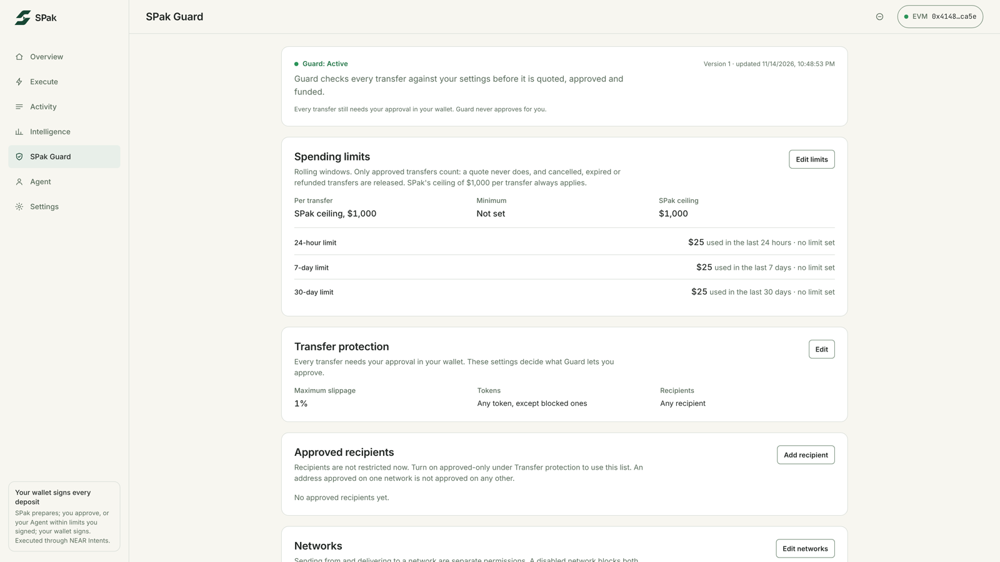
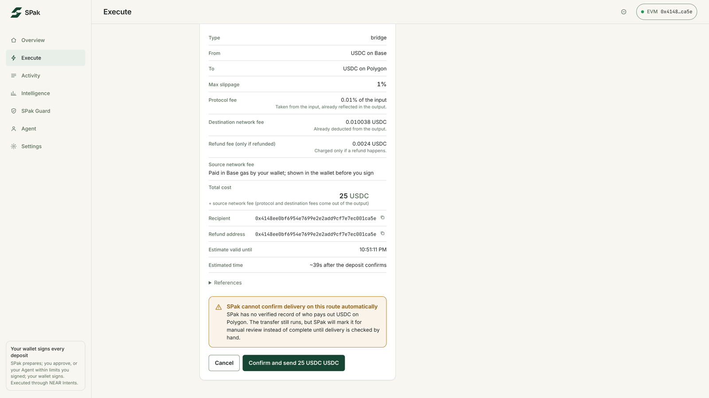

# SPak

Intelligent execution across chains.

You describe a cross-chain transfer in plain words. SPak turns it into an exact plan, checks it against your limits, gets a signed NEAR Intents quote, and has your own wallet sign the deposit. It marks the transfer complete only when the destination chain proves the funds arrived.

- Website: https://usespak.vercel.app
- App: https://usespak.vercel.app/app
- Demo video: [public/demo/spak-product-demo.mp4](public/demo/spak-product-demo.mp4) ([about the film](docs/SPAK-DEMO-VIDEO.md))


*The live website at usespak.vercel.app.*

## Contents

1. [The problem](#the-problem)
2. [The solution](#the-solution)
3. [Vision](#vision)
4. [Capabilities](#capabilities)
5. [Architecture](#architecture)
6. [How it works](#how-it-works)
7. [SPak-in](#spak-in)
8. [SPak Intelligence](#spak-intelligence)
9. [Portfolio](#portfolio)
10. [SPak Guard](#spak-guard)
11. [SPak Execution](#spak-execution)
12. [NEAR Intents](#near-intents)
13. [Networks and assets](#networks-and-assets)
14. [Security](#security)
15. [Product status](#product-status)
16. [Upcoming](#upcoming)
17. [Tech stack](#tech-stack)
18. [Repository structure](#repository-structure)
19. [Getting started](#getting-started)
20. [Documentation](#documentation)
21. [Demo video](#demo-video)

## The problem

Moving an asset from one chain to another still takes you through several decisions: which bridge, which network, whether the token is supported, whether you hold gas on the source chain, which deposit address, which fee is fair, and whether the funds arrived. Each step is a chance to send to the wrong place or overpay.

## The solution

SPak replaces those steps with one sentence and one review.

- You write "Move 100 USDC from Base to NEAR".
- SPak shows what you send, what you receive at minimum, every fee, and the recipient.
- You press one confirm. Your wallet signs. NEAR Intents routes and settles.
- SPak tracks the transfer and checks delivery on the destination chain.

SPak is non-custodial. It never holds keys or funds, and it never signs on your behalf.

## Vision

One interface where you state what you want to happen to your assets, and SPak handles the routing, the checks and the proof. Today that is one-off transfers you approve. Next come conditional and scheduled execution, scoped Agents and developer APIs. See [Upcoming](#upcoming).

## Capabilities

| Capability | What it does | Status |
|---|---|---|
| SPak-in | Reads a plain-language instruction into a typed plan. Deterministic rules, no language model | Live |
| Signed quotes | Fetches NEAR Intents 1Click quotes and verifies the quote signature | Live |
| One-click confirm | Firm quote, token approval and deposit in one confirm, signed by your wallet | Live |
| Delivery verification | Confirms delivery on the destination chain for 45 of 90 USDC routes. The rest are flagged for manual review before you start | Live |
| SPak Guard | Per-transfer and daily limits, allowed networks, assets and recipients | Live |
| SPak Intelligence | Read-only balances on 10 networks with independent prices, portfolio questions and route comparison | Live |
| Refund tracking | Tracks failed transfers until the refund is verified | Live |
| Guided tour | First-run tour of every screen | Live |
| SPak Agent | A NEAR identity for an Agent. Agents cannot move funds in this release | Partial |
| Mainnet settlement | No verified SPak mainnet settlement yet. A first controlled transfer is being prepared | In progress |

Full classification: [docs/SPAK-PRODUCT-OVERVIEW.md](docs/SPAK-PRODUCT-OVERVIEW.md).

## Architecture

```
You ── plain words ──▶ SPak-in ──▶ plan (typed, hashed)
                                     │
             SPak Intelligence ──────┤  balances, prices, feasibility (read-only)
             SPak Guard ─────────────┤  your limits, checked before quote and before deposit
                                     ▼
                              SPak Execution ──▶ NEAR Intents 1Click (signed quote, deposit address)
                                     │
                     your wallet signs the deposit
                                     ▼
                              Tracking ──▶ destination chain check ──▶ Complete / Refunded / Manual review
```

Details: [docs/SPAK-ARCHITECTURE.md](docs/SPAK-ARCHITECTURE.md).

## How it works

1. Intent. You type an instruction in the Execute view.
2. SPak-in. The instruction becomes a plan: action, amount, source and destination asset, recipient.
3. Intelligence. SPak checks your balance on the source network and flags a shortfall before the quote.
4. Guard. Your limits are checked.
5. Quote. SPak requests a signed NEAR Intents quote and shows every amount.
6. Confirm. One confirm fetches a firm quote, runs any token approval and sends the deposit from your wallet. If the firm minimum is worse than the one shown, SPak stops.
7. Verification. SPak watches the transfer and checks the destination chain before marking it complete.


*SPak-in reads the instruction and flags an empty balance before quoting (preview build, simulated wallet).*


*The review: amounts, minimum received, fees and recipient from a signed NEAR Intents quote.*


*One confirm runs the firm quote, approval and deposit steps in order.*

Step by step: [docs/SPAK-HOW-IT-WORKS.md](docs/SPAK-HOW-IT-WORKS.md).

## SPak-in

The instruction parser. It tokenises, classifies and validates text into a typed plan with fixed rules. It asks a question when an instruction is ambiguous and never guesses a contract, address, amount or network. Benchmark: [docs/BENCHMARK.md](docs/BENCHMARK.md). Details: [docs/SPAK-IN.md](docs/SPAK-IN.md).

## SPak Intelligence

A read-only layer over your linked wallets.

- Reads balances directly from each chain. An unreadable balance shows as unknown, never as zero.
- Prices with Chainlink first. CoinGecko is used only when it agrees with the provider price.
- Answers questions such as "How much USDC do I have?" inside the chat.
- Checks feasibility of a plan against your balance before the quote.

Details: [docs/SPAK-INTELLIGENCE.md](docs/SPAK-INTELLIGENCE.md).

## Portfolio

The Intelligence view lists balances across 10 networks with values, concentration insights and live route comparison for any holding. Route comparison requests real NEAR Intents quotes and moves nothing.


*Portfolio view. Data in this capture: a live read of public mainnet wallets, because the demo wallet is empty.*


*Live route quotes for a holding. Signatures checked, nothing moves.*

## SPak Guard

Your own policy. Per-transfer and daily spend limits, allowed networks, assets and recipients. Guard runs before the quote and again before the deposit, and fails closed.


*SPak Guard settings.*

Details: [docs/SPAK-GUARD.md](docs/SPAK-GUARD.md).

## SPak Execution

Accepts only plans SPak-in issued to you. Binds approval to the exact plan hash. Refuses changed plans, stale approvals, mismatched quotes and duplicates. Builds the deposit transaction for your wallet (EVM, Solana or NEAR, including NEAR storage registration) and records every state change. Details: [docs/SPAK-EXECUTION.md](docs/SPAK-EXECUTION.md), [docs/SPAK-DEPOSIT-FLOW.md](docs/SPAK-DEPOSIT-FLOW.md), [docs/SPAK-TRACKING.md](docs/SPAK-TRACKING.md).


*Transfer tracking. Complete only when the destination chain confirms delivery.*

## NEAR Intents

SPak uses the NEAR Intents 1Click API for quotes, deposit addresses and settlement. It is the only provider-specific code (`src/integrations/near-intents/`). The testnet build uses Tidepool, a third-party testnet sandbox that is not an official NEAR service, and labels it as such in the app.

## Networks and assets

Ethereum, Base, Arbitrum, Optimism, Polygon, BNB Chain, Avalanche, Gnosis, Solana and NEAR. Assets come from the NEAR Intents token registry; deprecated tokens are skipped. Routes where SPak cannot verify delivery automatically are marked for manual review before you start.


*A route SPak cannot verify automatically is labelled before you confirm.*

Full list and verification coverage: [docs/SPAK-SUPPORTED-NETWORKS.md](docs/SPAK-SUPPORTED-NETWORKS.md).

## Security

- No server-side signing. Your wallet signs every deposit.
- Wallet sign-in with signature verification for EVM, Solana and NEAR.
- Quote signatures verified. Firm quote re-checked against the shown minimum.
- Delivery checked against trusted payout senders on the destination chain.
- Secrets only in the host environment.

Details: [docs/SPAK-SECURITY.md](docs/SPAK-SECURITY.md).

## Product status

| Area | Status |
|---|---|
| Website, sign-in, SPak-in, quotes, one-click confirm, Guard, Intelligence, tracking, guided tour | Live in production |
| SPak Agent identity | Partial: cannot move funds |
| Verified mainnet settlement | Not yet |

## Upcoming

Conditional and scheduled execution, advanced Agents, developer APIs and SDKs, rebalancing. These are planned, not built. See [docs/SPAK-ROADMAP.md](docs/SPAK-ROADMAP.md).

## Tech stack

Next.js 15, React 19, TypeScript, Tailwind, Drizzle ORM, PostgreSQL (PGlite locally), Vitest, Playwright, viem, NEAR Wallet Selector, Wallet Standard. Hosted on Vercel with a Neon database. The demo film is built with Remotion.

## Repository structure

```
src/spak-in/                     SPak-in engine (deterministic, no LLM, no keys)
src/execution/                   Plan validation, asset resolution, quotes, execution records
src/integrations/near-intents/   NEAR Intents 1Click client
src/deposits/                    Deposit building and verification per chain family
src/auth/  src/wallets/          Wallet sign-in and browser wallet connectors
src/database/                    Drizzle schema, migrations, repositories
src/app/  src/components/        Website and app UI
tests/                           Unit, integration, database and browser checks
scripts/                         Registry sync, benchmark, migrations
video/                           Demo film source (Remotion)
docs/                            Product and technical documentation
```

## Getting started

Requirements: Node 20+.

    npm install
    cp .env.example .env.local   # all values optional
    npm run dev                  # http://localhost:3000

Without `DATABASE_URL`, local development uses an embedded PGlite database. Production needs Postgres and `SPAK_APP_ORIGIN`.

| Command | What it does |
|---|---|
| `npm test` | Unit, integration, database and benchmark tests |
| `npm run test:live` | Dry quote against the real NEAR Intents API. Moves no funds |
| `npm run bench` | SPak-in accuracy and latency |
| `npm run typecheck` / `npm run lint` | Strict TypeScript / ESLint |
| `npm run registry:sync` | Rebuild the asset registry |
| `npm run db:migrate` | Apply migrations to `DATABASE_URL` |

Testnet setup: [docs/SPAK-TESTNET-SETUP.md](docs/SPAK-TESTNET-SETUP.md).

## Documentation

- [Product overview](docs/SPAK-PRODUCT-OVERVIEW.md)
- [Architecture](docs/SPAK-ARCHITECTURE.md)
- [How it works](docs/SPAK-HOW-IT-WORKS.md)
- [SPak-in](docs/SPAK-IN.md)
- [SPak Intelligence](docs/SPAK-INTELLIGENCE.md)
- [SPak Guard](docs/SPAK-GUARD.md)
- [SPak Payments](docs/SPAK-PAYMENTS.md)
- [SPak Execution](docs/SPAK-EXECUTION.md)
- [Supported networks](docs/SPAK-SUPPORTED-NETWORKS.md)
- [Security](docs/SPAK-SECURITY.md)
- [Roadmap](docs/SPAK-ROADMAP.md)
- [Demo video](docs/SPAK-DEMO-VIDEO.md)
- [Brand guidelines](docs/SPAK-BRAND-GUIDELINES.md)

## Demo video

A 96-second product film built from real captures of the website and the app: [public/demo/spak-product-demo.mp4](public/demo/spak-product-demo.mp4). App footage comes from a preview build with a simulated, empty wallet. No transfer was made and none is shown as settled. Source and provenance: [video/README.md](video/README.md).
