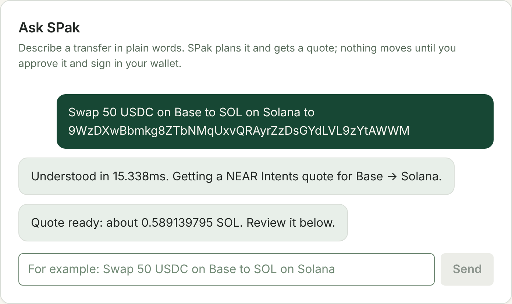
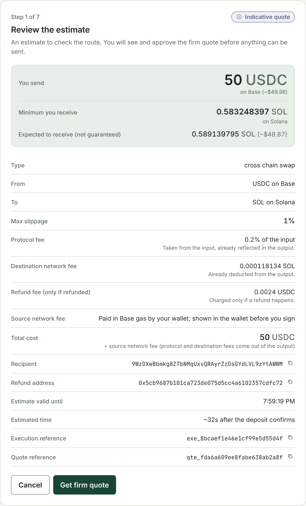
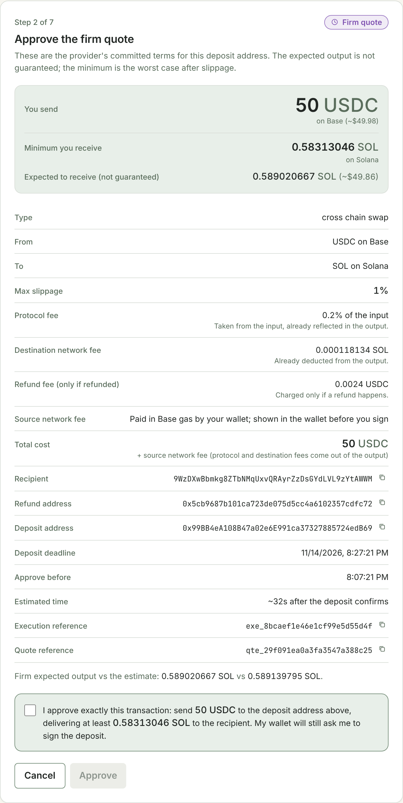
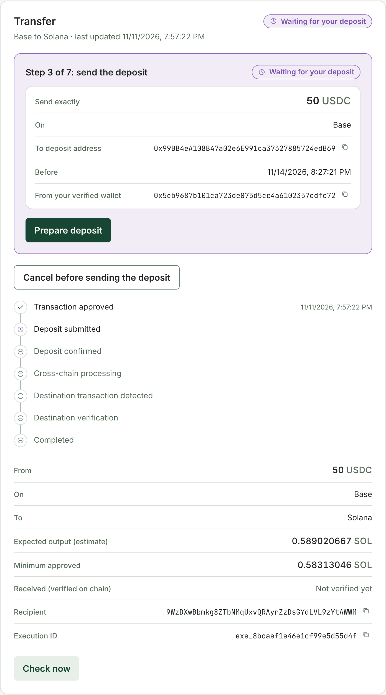
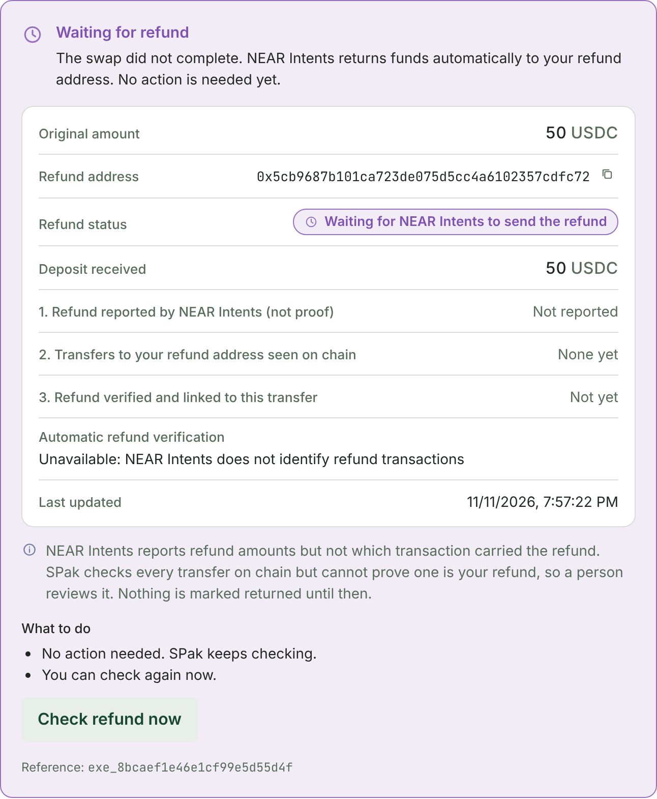

# SPak

SPak is a cross-chain execution agent built on NEAR Intents. You write what you want in plain words. SPak turns it into a checked plan, gets a firm quote, waits for your approval, helps you send the deposit from your own wallet, and tracks the transfer until delivery is verified on the destination chain.

> Swap 50 USDC on Base to SOL on Solana

SPak never holds your keys and never signs for you. Your wallet signs and sends. Nothing moves without your approval.


## What problem it solves

Moving value across chains means picking a bridge, finding the right token on the right network, copying addresses and watching several explorers. One wrong network or address can lose funds.

SPak replaces that with one instruction:

- You say what you want.
- SPak checks every field against real registries and asks when something is unclear.
- You see the full quote, with every fee, and approve that exact plan.
- SPak tracks the transfer and marks it complete only after it has verified delivery on chain.

## The website and the app

The marketing site lives at `/`, with developer pages at `/developers` and `/docs`. The app lives at `/app`. Both share one design system, with a light and a dark theme.

| Desktop | Phone |
|---|---|
|  |  |

Dark theme:


## How a transfer works

1. **Describe it.** Type the transfer in chat, or use the manual swap form.
2. **SPak prepares the plan.** SPak-in reads the sentence with fixed rules and no language model. It validates networks, assets, addresses and amounts, and applies your SPak Guard limits. The plan is hashed so it cannot change after you approve it.
3. **Review the estimate.** NEAR Intents gives an indicative quote. You see the amount you send, the minimum you receive, every fee, the recipient and the refund address.
4. **Approve the firm quote.** The firm quote has a deposit address and a deadline. You approve it within 10 minutes. The approval is bound to that exact plan and quote.
5. **Send the deposit.** SPak prepares the transaction and checks your balance. Your wallet asks you to sign. SPak receives only the transaction reference.
6. **SPak verifies the deposit** on the source chain. It compares every field with the deposit requirements.
7. **NEAR Intents executes.** SPak follows the provider status.
8. **SPak verifies delivery** on the destination chain. Only then is the transfer marked completed.

The app shows seven steps: transaction approved, deposit submitted, deposit confirmed, cross-chain processing, destination transaction detected, destination verification, completed.

## Product screens

Captured from the running app. The quotes are real NEAR Intents quotes. The wallet is a throwaway test wallet and no funds move. The refund screen uses simulated tracking responses.

| Ask SPak | Review the estimate |
|---|---|
|  |  |

| Approve the firm quote | Track the transfer |
|---|---|
|  |  |

When a transfer fails, SPak shows what happened and what you can do. Simulated example:



## What SPak can do

| Module | What it does | Status |
|---|---|---|
| Agent | A NEAR account that represents you inside SPak. Your connected wallets stay yours and keep signing | Partly live |
| Intelligence | Reads swaps, bridges, transfers and payments written in plain words. Same sentence, same result | Partly live |
| Guard | Controls between an instruction and your funds: approval, limits, slippage | Partly live |
| Payments | Pay someone on another network from the asset you hold | Partly live |
| Conditional Execution | Scheduled and price-conditional instructions are understood and planned. They do not run yet | Planned |
| Connect | Sign in with an EVM, Solana or NEAR wallet | Partly live |

SPak-in understands 12 intents.

| Intent | Example | Runs today |
|---|---|---|
| Swap | `swap 100 usdc to eth on base` | Yes, with an exact amount |
| Cross-chain swap | `swap 50 usdc on base to sol on solana` | Yes, with an exact amount |
| Bridge | `bridge 0.5 eth from ethereum to near` | Yes, with an exact amount |
| Cross-chain transfer | `transfer 50 usdc from base to arbitrum` | Yes, with an exact amount |
| Payment | `send 20 usdc from base to 0x… on arbitrum` | Yes, with an exact amount |
| Rebalance | `rebalance to 50% eth and 50% usdc` | Understood and planned only |
| Scheduled | `every friday at 6pm transfer 25 usdc from base to arbitrum` | Understood and planned only |
| Conditional | `swap 50 usdc to eth on base when eth drops below 2000` | Understood and planned only |
| Portfolio query, status, history, cancel | `show my transaction history`, `what is my portfolio worth` | Understood only |

Scope: 19 networks and 169 assets, generated from the NEAR Intents token list. For known networks SPak cannot use, such as Fantom, SPak says "not supported" instead of "unknown".

## Safety rules

Enforced in code and covered by tests.

- SPak never holds keys, never signs and never sends funds. Your wallet signs and sends the deposit.
- A deposit address is created only after explicit approval bound to the exact plan hash.
- SPak accepts only plans SPak-in issued to you. It refuses changed plans, stale approvals, mismatched quotes and duplicates.
- Only a firm quote can be approved. A new quote, a requote or a cancel cancels the approval.
- Ambiguous instructions stop with a question. Nothing is guessed: no invented contracts, addresses, amounts or networks.
- `send` and `pay` never default to your own wallet. They need an explicit recipient.
- A refund address on the source network is required.
- The largest transfer SPak will approve is capped by `SPAK_MAX_EXECUTION_USD` (default 1000). If the USD value is unknown, approval fails closed.
- A transfer with a submitted or confirmed deposit cannot be cancelled.
- A delay never becomes a failure. A transfer is marked failed only when the provider says so.
- Success shows only after SPak verifies delivery on the destination chain.
- All money math uses fixed-point integers. No floating point touches an amount.

## Failures and refunds

NEAR Intents refunds automatically to the refund address SPak sets, which is your verified source wallet. There is nothing for you to sign.

NEAR Intents reports refund amounts but does not say which transaction carried the refund. SPak checks every transfer to your refund address on chain. When it cannot prove one is your refund, a person reviews the case. Nothing is marked returned until the transfer is verified. Details: [docs/SPAK-FAILURE-REFUNDS.md](docs/SPAK-FAILURE-REFUNDS.md).

## Wallet sign-in

You sign in by signing a one-time message with a wallet you own. There are no passwords or emails. SPak never asks for a private key or seed phrase.

| Family | Connection | Message |
|---|---|---|
| EVM | EIP-6963 wallet discovery | Sign-In with Ethereum |
| Solana | Wallet Standard | Sign-In with Solana |
| NEAR | NEAR Wallet Selector (Meteor) | NEP-413 |

NEAR sign-in needs a full-access key. Function-call keys are refused because they cannot prove control of the account. Details: [docs/AUTH.md](docs/AUTH.md).

## Accuracy

Measured by `npm run bench`. Latency is local engine time with no network.

| Set | Cases | Classification | Entity extraction | Unsafe validations |
|---|---|---|---|---|
| Main set | 219 | 99.5% | 100% | 0 |
| Held-out set | 40 | 85% | 89.7% | 0 |

The engine was tuned against the main set, so treat it as a regression suite. The held-out set was written after tuning and is the better estimate for phrasing SPak has not seen. See [docs/BENCHMARK.md](docs/BENCHMARK.md).

## Status

What has been checked, and how:

- 417 automated tests.
- Live NEAR Intents indicative and firm quotes, with no funds sent.
- Deposit and destination verifiers run against real Base, Solana and NEAR mainnet data. These are read-only checks.
- Wallet sign-in with real MetaMask and Phantom extensions on throwaway wallets with no funds. Sign-in only.
- Deposit sending with simulated wallets: send, wrong network, wrong account, locked wallet, rejection and disconnect.

What has not been checked:

- **No real deposit has been sent.** The path to a real 1Click deposit address is untested with real funds. Provider states such as processing, completed, refunded and failed are tested against a mocked provider.
- **Refund evidence.** Whether NEAR Intents lists refund transactions in `originChainTxHashes` is unconfirmed until [docs/REFUND-LIVE-TEST.md](docs/REFUND-LIVE-TEST.md) is run with real funds.
- **A full NEAR sign-in with a real NEAR account.** It is covered by automated tests and a live mainnet key lookup.

Not built yet:

- Sending a NEAR deposit from inside SPak. NEAR deposits are manual.
- Balance reader and price feed. Percentage amounts, fiat amounts and rebalancing are planned but not executed.
- Scheduler and condition monitor for scheduled and conditional instructions.
- Creating a NEAR account for the agent, and stored Guard settings. Autonomous execution is off.

## Stack

Next.js 15, React 19, TypeScript, Tailwind CSS 4, Zod, Drizzle ORM with Postgres, Vitest. Wallets through EIP-6963, Wallet Standard and NEAR Wallet Selector. Execution runs on the NEAR Intents 1Click API.

## Run it locally

Requirements: Node 20 or newer.

```
npm install
cp .env.example .env.local
npm run dev
```

Open http://localhost:3000 for the site and http://localhost:3000/app for the app. Without `DATABASE_URL`, local development uses an embedded PGlite database in `.data/pglite`. Production needs Postgres and `SPAK_APP_ORIGIN`.

```
DATABASE_URL=postgres://… npm run db:migrate
```

| Variable | Purpose |
|---|---|
| `DATABASE_URL` | Postgres for users, sessions, wallets, intents, executions and the audit log |
| `SPAK_APP_ORIGIN` | Public origin of the app. Used for sign-in domain binding and CSRF checks |
| `ONECLICK_API_KEY` | NEAR Intents partner key, server side only. Without it, quotes carry a 0.2% default fee |
| `SPAK_MAX_EXECUTION_USD` | Largest transfer SPak will approve. Default 1000 |
| `SPAK_RPC_<NETWORK>` | Optional RPC endpoints per network. Public endpoints rate-limit |
| `CRON_SECRET`, `SPAK_MONITOR_SECRET` | Bearer tokens for `/api/internal/monitor`. 32 or more random characters |
| `SPAK_ADMIN_TOKEN`, `SPAK_REVIEWERS` | Access for the manual review API |

All other values in `.env.example` are optional.

## Commands

| Command | What it does |
|---|---|
| `npm run dev` | Start the site and app on port 3000 |
| `npm run build` | Production build |
| `npm test` | Unit, integration, database, brand, marketing and benchmark tests |
| `npm run test:live` | Read-only checks against NEAR Intents and mainnet RPCs. Moves no funds |
| `npm run bench` | Accuracy and latency on both benchmark sets. Add `-- --write` to update docs/BENCHMARK.md |
| `npm run typecheck` | Strict TypeScript |
| `npm run lint` | ESLint |
| `npm run registry:sync` | Rebuild the asset registry from the NEAR Intents token list |
| `npm run db:generate` | New migration after a schema change |
| `npm run db:migrate` | Apply migrations to `DATABASE_URL` |

## API

| Group | Purpose |
|---|---|
| `/api/spak-in/*` | Read an instruction, return a validated plan, list the registry |
| `/api/auth/*` | Wallet sign-in challenge, verify, session and logout |
| `/api/wallets` | Your verified wallets |
| `/api/agent/identity` | Link a NEAR identity |
| `/api/quotes`, `/api/executions/*` | Create an execution, get quotes, approve, cancel, track |
| `/api/deposits/*` | Prepare, submit, verify and reject deposits |
| `/api/internal/monitor` | Background tracking. Needs a bearer secret. A GitHub Actions workflow calls it every 5 minutes |
| `/api/admin/reviews/*` | Manual review of refund cases. Needs a reviewer token |

## Project layout

```
src/spak-in/          Intent engine (deterministic, no LLM, no keys)
src/execution/        Plan validation, asset resolution, quotes, execution records and states
src/deposits/         Deposit builder and on-chain verifiers
src/tracking/         Monitor and destination verification
src/failures/         Failure classification, refunds and manual review
src/auth/             Wallet sign-in, sessions, wallets
src/wallets/          Browser wallet connectors
src/integrations/     NEAR Intents 1Click client, the only provider-specific code
src/database/         Drizzle schema, migrations, repositories
src/design/           Brand tokens: colour, type, spacing
src/marketing/        Copy that makes product claims
src/app/              Site (marketing), app, API routes
src/components/       UI components
tests/                Engine, execution, deposits, tracking, failures, brand, marketing, live tests
scripts/              Registry sync, benchmark, migrations, screen capture
docs/                 Reference docs and screenshots
```

## Docs

- [SPak-in engine](docs/SPAK-IN.md)
- [Wallet sign-in](docs/AUTH.md)
- [SPak Execution](docs/SPAK-EXECUTION.md)
- [Deposit flow](docs/SPAK-DEPOSIT-FLOW.md)
- [Tracking](docs/SPAK-TRACKING.md)
- [Failures and refunds](docs/SPAK-FAILURE-REFUNDS.md)
- [Benchmark](docs/BENCHMARK.md)
- [Marketing website](docs/SPAK-MARKETING-WEBSITE.md)
- [Brand guidelines](docs/SPAK-BRAND-GUIDELINES.md)
