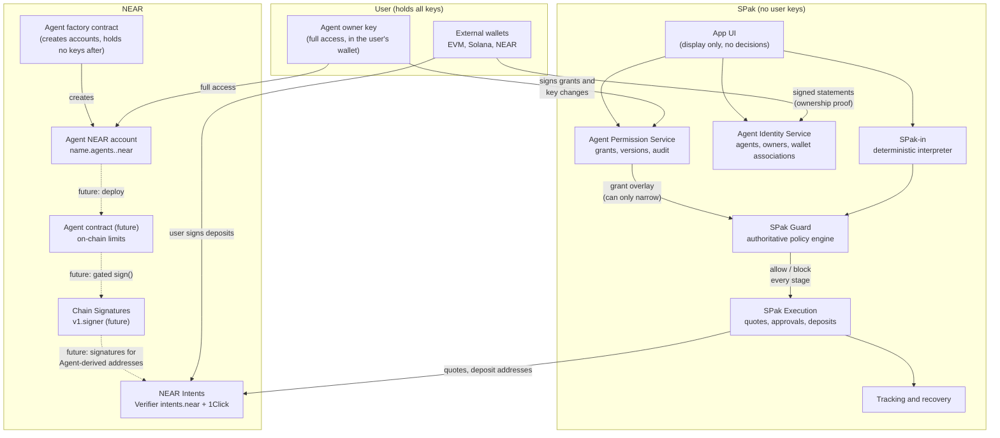
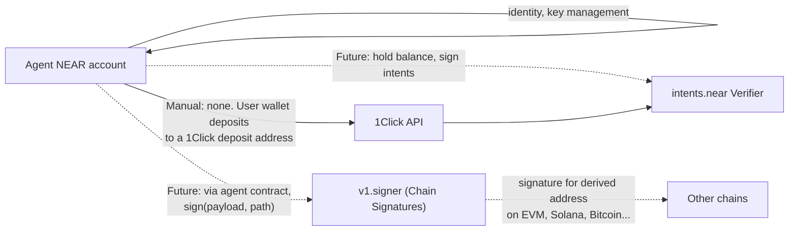
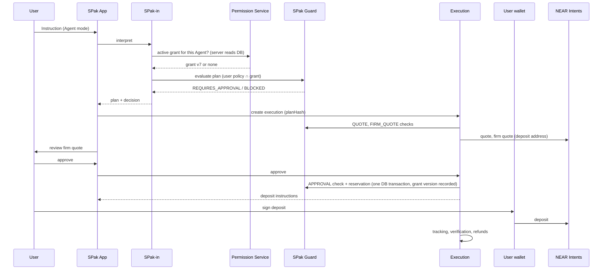

# SPak Agent architecture

Status: proposal for review. Nothing in this document is implemented unless the section "What exists today" says so.

Related: [Identity model](SPAK-AGENT-IDENTITY-MODEL.md), [Permissions](SPAK-AGENT-PERMISSIONS.md), [Security](SPAK-AGENT-SECURITY.md), [User flows](SPAK-AGENT-USER-FLOWS.md), [Roadmap](SPAK-AGENT-ROADMAP.md).

## 1. What exists today (verified in the repository)

| Area | State | Where |
|---|---|---|
| Wallet sign-in and linking | Live. EVM (EIP-4361 style), Solana (SIWS style), NEAR (NEP-413). One-time challenges, 5 minute expiry, server-side verification, unique `(family, address)` | `src/auth/`, `docs/AUTH.md` |
| Sessions | Live. HttpOnly cookie, hashed token, 7 day absolute and 24 hour idle expiry, logout and logout-all | `src/auth/service.ts` |
| Agent identity (Stage 5) | Implemented: `spak_agents`, NEP-413 ownership proof checked on chain, off-chain attestation, lifecycle, audit trail. See identity model section 8 |
| Linked NEAR wallet (earlier) | Foundation only. Table `spak_agent_identities` (one row per user, status `NOT_LINKED` or `LINKED`, optional `nearAccountId` taken from a verified NEAR wallet). No keys, no signing, no permissions | `src/database/schema.ts`, `src/app/api/agent/identity/route.ts` |
| Access mode | SPak-in accepts `MANUAL` or `AGENT`. `AGENT` is only honoured when the identity is `LINKED`, and autonomy is forced off on the server | `src/app/api/spak-in/interpret/route.ts` |
| SPak Guard | Live in code, not deployed. Per-user policy, server-side enforcement at plan, quote, firm quote, approval and deposit, spending reservations | `docs/SPAK-GUARD-*.md` |
| Execution | NEAR Intents 1Click deposit-address flow. The user's own wallet sends every deposit. SPak signs nothing | `docs/SPAK-EXECUTION.md` |

Consequence: today the "Agent" is a label on a NEAR wallet the user already owns. It has no authority of its own. That is the gap this architecture closes.

## 2. Principles (non-negotiable)

1. Manual Access works without a NEAR account.
2. The Agent is a NEAR account dedicated to SPak use, not a label on a personal wallet.
3. External wallets stay under their owners' keys. Associating a wallet proves ownership; it grants no signing authority.
4. SPak never holds a user's seed phrase or private key, and never holds a full-access key to a user's Agent account.
5. Every Agent permission is explicit, scoped, expiring and revocable. The default is identity only.
6. SPak Guard is authoritative. Agent permissions can only narrow what Guard allows.
7. Manual approval is the default. Autonomous execution is future work behind its own stage.
8. NEAR Intents settles; Chain Signatures signs; NEAR accounts identify and authorise. Each has one job.
9. Security-critical operations fail closed.

## 3. Components and responsibilities

| Component | Owns | Never does |
|---|---|---|
| App UI | Shows server state, collects signatures from the user's wallets | Decide policy or permissions |
| SPak-in | Turns text into a plan. Deterministic, no model | Grant authority, move funds |
| Agent Identity Service (new) | Agent records, owner binding, wallet associations, lifecycle state | Store private keys |
| Agent Permission Service (new) | Grants signed by the owner, versions, expiry, revocation, audit trail | Widen Guard, act without a valid grant |
| SPak Guard (existing) | Final policy decision at every stage, spending reservations | Get bypassed: it is called inside execution and inside the approval transaction |
| SPak Execution (existing) | Quotes, approvals bound to plan and quote, deposit instructions | Sign for the user |
| Agent factory contract (new, on NEAR) | Create the Agent account with the owner's public key as its only full-access key | Keep a key on the created account |
| Agent contract (future) | On-chain limits that hold even if SPak is compromised | Exist before autonomy is designed and reviewed |
| NEAR Intents | Cross-chain settlement (Verifier `intents.near`), quoting and deposit addresses (1Click) | Identify SPak users: 1Click deposit flows do not need a NEAR account |
| Chain Signatures (future) | MPC signatures for addresses derived from the calling NEAR account and a path | Control existing external wallets |

## 4. How the NEAR pieces fit

Verified facts and their sources are in [Identity model, section 2](SPAK-AGENT-IDENTITY-MODEL.md#2-verified-near-capabilities). In short:

- **NEAR account** = identity and authorisation. Full-access keys can do anything; function-call keys can only call one contract (optionally named methods), cannot attach NEAR, and have a gas allowance. Only an account can create its own sub-accounts.
- **NEAR Intents** = settlement. The 1Click API gives SPak deposit addresses and statuses; users do not need NEAR accounts for this. The Verifier `intents.near` keeps balances per NEAR account id and accepts intents signed with several standards. Every key registered there has full control of that account's Verifier balance; there is no documented per-key scoping.
- **Chain Signatures** = signing for other chains. The `v1.signer` contract signs payloads for addresses derived from the calling NEAR account and a path. It cannot sign for a wallet that already exists elsewhere.
- **Contracts** = the place to put rules that must hold without trusting SPak's servers (future agent contract).

## 5. Transaction authorisation flow (Agent mode, manual approval)

Agent mode does not change who signs. The difference is that the request is attributed to the Agent and checked against its grants as well as Guard.

## 6. Data the new services need (design, not migrations)

| Table (proposed) | Purpose |
|---|---|
| `spak_agents` | One row per Agent: id, owner user id, NEAR account id, creation method (`CREATED` or `LINKED`), status, created and updated times. Replaces the single-row `spak_agent_identities` model; a migration maps existing rows |
| `spak_agent_owner_keys` | Public keys observed as full-access on the Agent account, refreshed from chain. Never private keys |
| `spak_agent_wallets` | Associations: agent id, wallet id, signed statement, signature, expiry, status, revoked reason |
| `spak_agent_grants` | Permission grants: agent id, version, scope (JSON), signed statement, signature, signer key, valid from and until, status |
| `spak_agent_events` | Append-only lifecycle and permission audit trail |

The existing `spak_wallets` table stays the source of truth for ownership. Agent tables reference it.

## 7. Contradictions with the current code to resolve

1. `spak_agent_identities` has a unique index on `user_id`: one Agent per user. The proposal allows several later, so the new table must not carry that constraint.
2. Linking today copies `nearAccountId` from any verified NEAR wallet. Under the proposal, a linked personal NEAR account is allowed only as a transitional "linked" Agent with identity-only permissions (see the identity model).
3. Removing the NEAR wallet today silently unlinks the Agent. Under the proposal, it suspends the Agent and records an event.
4. The marketing copy promises SPak Agent "acting on its own" as planned. That stays true only while it is labelled planned.

## 8. Decisions that need owner input

See [Roadmap, unresolved decisions](SPAK-AGENT-ROADMAP.md#unresolved-decisions).
