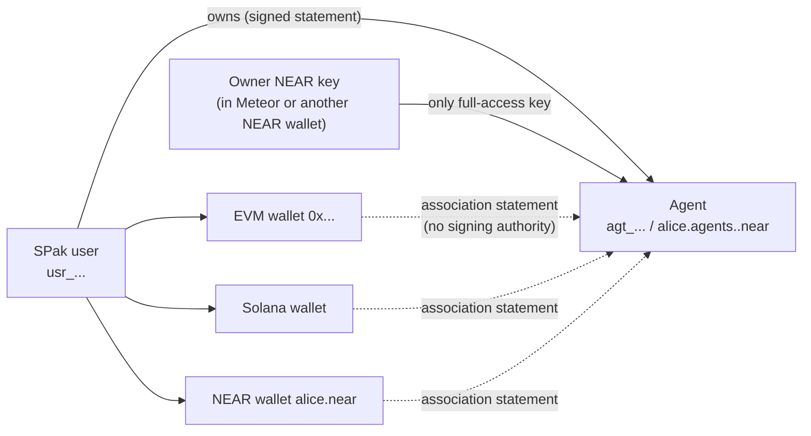
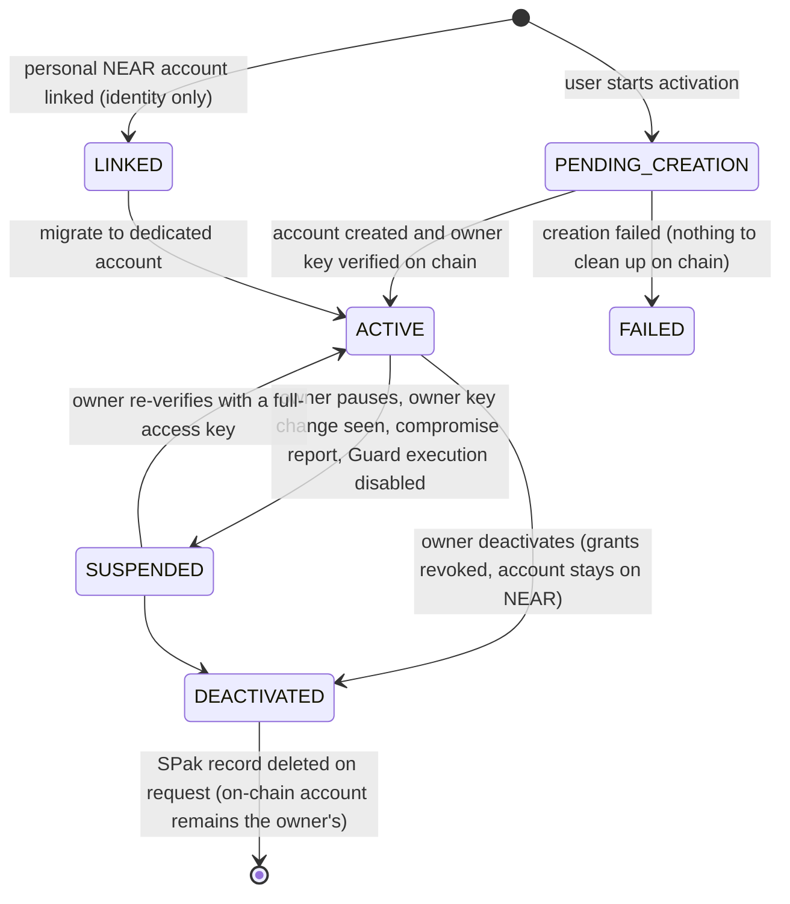
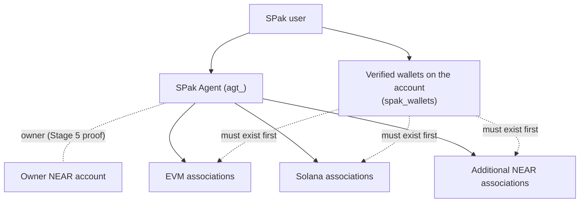
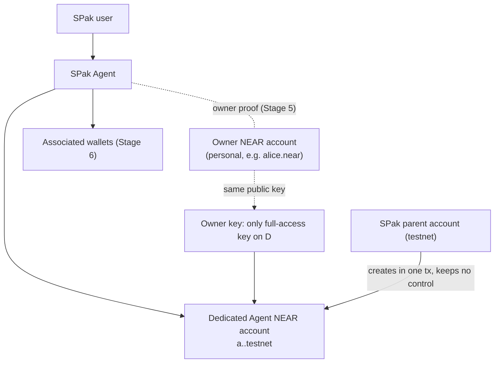

# SPak Agent identity model

Status: proposal for review.

## 1. What identifies a SPak Agent

A SPak Agent is a **NEAR account dedicated to SPak use**, bound to one SPak user (the owner).

- Its permanent identifier is the NEAR account id, for example `alice.agents.<spak-parent>.near`.
- Internally it also has a SPak id (`agt_...`) so records survive an identity migration.
- Its authority comes only from keys the owner holds and grants the owner signs. Creating the account grants no authority over any other wallet.

## 2. Verified NEAR capabilities

Each row: verified fact, source, limitation, and what it means for SPak. Pages were read on 2026-11-13.

| Capability | Verified fact | Source | Limitation | SPak implication |
|---|---|---|---|---|
| Account types | Named (`alice.near`), implicit (64 hex), Ethereum-like (`0x...`), deterministic (`0s...`) and universal (`0u...`) account ids exist | docs.near.org/protocol/accounts-contracts/account-id.md | Implicit accounts must be funded (can be 0 NEAR) before they sign | A named account gives the Agent a readable, stable identity |
| Sub-accounts | "Accounts cannot create sub-accounts of other accounts." Only `parent.near` creates `x.parent.near`. "Accounts have no control over their sub-account" | same | SPak must own a parent account to issue names under it | Agent names live under a SPak-owned parent. The parent has no control over them after creation |
| Full-access keys | Can transfer NEAR, delete the account, create sub-accounts, add or remove keys, deploy contracts, call any contract | docs.near.org/protocol/access-keys | Anyone with one controls the account | Only the owner holds full-access keys. SPak never does |
| Function-call keys | Can call only `receiver_id`, optionally only listed methods; "do not allow to attach NEAR tokens"; optional gas allowance that cannot be changed later | same | Allowance exhausted means the key is unusable; a new key is needed | The only key type SPak could ever hold, and only for a SPak-controlled agent contract, in a future stage |
| Key management | Adding a key needs a full-access key or a method in the account's own contract | same | Removing all keys locks the account | Key changes are owner actions, signed in the owner's wallet |
| Recovery | No protocol-level or social recovery is described. Losing the only full-access key locks funds "forever". Backup keys are the documented mitigation | docs.near.org/protocol/network/token-loss.md | Recovery depends on the user keeping a second key | SPak cannot promise recovery. It can prompt for a backup key |
| Meta-transactions | NEP-366: user signs a `DelegateAction`, a relayer pays gas. One receiver per meta-transaction; the sender account must exist | docs.near.org/protocol/transactions/meta-tx.md | No atomicity across receivers | SPak can pay gas for owner-signed Agent setup actions without holding keys |
| NEAR Intents identity | Verifier identifies users by NEAR account id. "Users do not need to create a NEAR account to use NEAR Intents." Named accounts register keys with `add_public_key` and remove them with `remove_public_key` | docs.near-intents.org/integration/verifier-contract/account-abstraction.md | "Each key has full control and can add or remove other keys" | Never register an external wallet key on the Agent's Verifier account by default: it would get full control of that balance |
| Intent signing | Verifier accepts `nep413`, `erc191`, `tip191`, `raw_ed25519`, `webauthn`, `ton_connect`, `sep53` | .../signing-intents.md | No delegation or session keys documented | Future Agent-held Verifier balances need their own key policy |
| 1Click | Deposit-address flow: quote, user deposits, status polling. "1Click does not take custody" | .../1click-api/about-1click-api.md | Partner JWT needed for normal fees | Manual Access keeps working without NEAR accounts |
| Chain Signatures | `v1.signer` (mainnet), `v1.signer-prod.testnet`. `sign(payload, path, domain_id)` with Secp256k1 or Ed25519. Address derived from the calling NEAR account, the path and the MPC key; MPC nodes, none signs alone | docs.near.org/chain-abstraction/chain-signatures, .../implementation | Outbound signing only. No documented way to control an existing external key. Fees, latency and threshold values not documented on these pages | Future Agent-derived addresses only. Never a way to act for a user's MetaMask or Phantom wallet |

Not verified (assumptions to check before building): account creation storage cost; which parent account SPak can own (`spak.near` availability); Chain Signatures deposit per call; MPC latency.

## 3. Account models compared

| Model | How it works | Meaningful NEAR identity | User keeps control | SPak custody risk | Verdict |
|---|---|---|---|---|---|
| A. Link a personal NEAR wallet (today) | User's existing `alice.near` is labelled the Agent | Weak: it is the user's personal account | Yes | None | Keep only as a transitional, identity-only option |
| B. SPak-held implicit account | SPak generates and stores a key | Yes | No | Custodial: SPak holds keys | Rejected. Violates "no private keys" |
| C. Dedicated named Agent account, owner-keyed (recommended) | SPak's factory creates `name.agents.<parent>.near` in one transaction with the owner's public key as the only full-access key | Yes: a separate account for SPak use | Yes | None: SPak never has a key on it | Recommended |
| D. Agent contract account | Model C plus an agent contract deployed by the owner with on-chain limits | Strongest | Yes | Low, if the contract is reviewed | Future, required before autonomy |
| E. Implicit account from a key the user generates | Account id is the hex of the user's public key | Yes, but unreadable | Yes | None | Allowed fallback if the named parent is not available |

### Recommendation: model C now, model D before autonomy

- **Why C.** It gives the Agent its own NEAR account, separate from the user's personal funds, with a readable name and on-chain history. The owner's wallet holds the only full-access key from the first block, so SPak never had custody. It works with NEP-366 so SPak can pay creation gas.
- **Why not A as the target.** A personal account mixes the user's savings with Agent activity, and any future function-call key or contract would sit on their main account.
- **How C is created.** The factory contract on the SPak parent account calls `CreateAccount`, `AddKey(owner public key, full access)` and `Transfer(initial storage deposit)` as one batch. The factory adds no key of its own. SPak verifies on chain afterwards that the only full-access key is the owner's.

## 4. Owner binding

- The owner proves control of the Agent by signing a NEP-413 message with a full-access key of the Agent account. SPak checks the key is currently a full-access key on chain (RPC `view_access_key`).
- Ownership is re-checked on chain at grant time and periodically. If the owner key is removed on chain, the Agent is suspended.

## 5. Questions answered

| Question | Answer |
|---|---|
| Does every user get a NEAR account? | No. Only users who activate SPak Agent. Manual Access users never need one |
| Existing NEAR account connected? | It can be the owner key holder (its key becomes the Agent's full-access key), or a linked identity-only Agent (model A). It is never silently converted |
| Activate without disconnecting wallets? | Yes. Wallets are associated, not replaced |
| Multiple wallets per Agent? | Yes, any number, each with its own signed association, per family and network |
| Multiple Agents per user? | Data model allows it (`spak_agents` has no unique owner constraint). The first release limits it to one; the UI and permissions are per Agent from day one |
| Internal representation | `agt_` id, NEAR account id, owner user id, creation method, status, key snapshot, version counter |

## 6. Wallet association

Association answers "this wallet belongs to the same person as this Agent". It never lets the Agent sign for the wallet.

1. The wallet is already verified in `spak_wallets` (existing challenge flow).
2. SPak builds a statement: app domain, user id, Agent NEAR account id, wallet address and family, purpose `AGENT_ASSOCIATION`, nonce, issued-at, expiry.
3. The wallet signs it with its native standard (EIP-4361 style, SIWS style, NEP-413). The server verifies against its own stored copy, consumes the nonce once, and stores signature and statement.
4. Associations expire (proposal: 180 days) and must be re-signed. An expired association is ignored, not deleted.

| Event | Effect |
|---|---|
| Wallet removed by the user | Association revoked immediately. Pending executions that need it stop at the next Guard stage. Logged |
| Wallet reported compromised | Association revoked, wallet blocked from re-association for that user until confirmed, all Agent grants paused, user notified |
| Same address claimed by another user | Refused: `(family, address)` is unique across users today and stays so |
| Multiple wallets on one network | Allowed. Each grant names which wallet it may use |

## 7. Lifecycle

| Action | Who | Needs |
|---|---|---|
| Create | Owner | Owner wallet signature (NEP-413 on the request, then the public key for the factory) |
| Activate | Owner | On-chain check that the owner key is the only full-access key |
| Suspend | Owner or SPak (automatic on risk signals) | Session for owner. Automatic suspension needs no signature, because it only removes authority |
| Resume | Owner | Fresh NEP-413 signature from a current full-access key |
| Associate or remove a wallet | Owner | Association: that wallet's signature. Removal: session only |
| Grant or widen permissions | Owner | NEP-413 signature from the Agent's full-access key over the exact grant |
| Revoke or narrow permissions | Owner | Session only. Taking authority away must never wait for a signature |
| Recover | Owner | Only through a backup full-access key the owner added. SPak cannot recover a lost key |
| Migrate identity | Owner | Signatures from both the old and new accounts |
| Delete | Owner | Session plus confirmation. Deletes SPak records; the NEAR account stays under the owner's keys |

## 8. Stage 5 implementation (built)

This section describes code on `feature/spak-agent-identity`. Everything above it is the target design.

### Implemented vs planned

| Capability | Status |
|---|---|
| Agent identity record, independent of wallets, no NEAR account needed | Implemented |
| Lifecycle `CREATED → PENDING_VERIFICATION → VERIFIED`, `SUSPENDED`, `REVOKED` (terminal) | Implemented |
| Ownership proof: NEP-413 signature from a full-access key of a NEAR account, checked on chain | Implemented |
| Off-chain ownership attestation (canonical record + sha256), stored in SPak's database | Implemented, labelled "not on chain" everywhere |
| Append-only audit trail (database trigger refuses updates) | Implemented |
| On-chain ownership attestation (registry contract) | Not implemented. Designed below; blocked on decisions |
| Dedicated Agent NEAR account | Not implemented (Stage 7). The API always returns `dedicatedAccount.state = NOT_AVAILABLE` |
| Wallet association, permission grants, Chain Signatures, autonomy | Not implemented |

### Separate concepts, kept separate

| Concept | Proves | Implemented by |
|---|---|---|
| Application login | The user holds a SPak session | Session cookie (`docs/AUTH.md`) |
| Ownership proof | The user controls a full-access key of a NEAR account, now | `POST /api/agents/:id/verify` |
| Off-chain attestation | SPak recorded that proof (hash of the exact record) | `spak_agents.attestation_hash` |
| On-chain attestation | A public, independently verifiable record | Not built |
| Wallet association, transaction authorisation | Later stages | Not built |

A login never sets ownership. Only a valid proof sets the owner fields and `VERIFIED`. No step grants permission to move funds.

### Challenge and proof

1. `POST /api/agents/:id/challenge { accountId }` issues a one-time challenge. It stores the exact message, a 32-byte nonce, the recipient (the server's configured origin host, never the request body), purpose `AGENT_OWNERSHIP`, method `NEAR_NEP413_FULL_ACCESS_KEY`, issue and expiry times (5 minutes).
2. The signed message names: Agent id, a privacy-preserving user reference (`spak-user:` + truncated sha256, never the raw user id), NEAR account, purpose, method, domain, issue and expiry times, challenge id.
3. The wallet signs it with NEP-413 (`signMessage`, recipient = app host, the challenge nonce).
4. `POST /api/agents/:id/verify` consumes the challenge atomically (`UPDATE ... WHERE used_at IS NULL AND expires_at > now`), then verifies with the existing `verifyNearSignature`:
   - ed25519 signature over the NEP-413 payload of the stored message, nonce and recipient;
   - implicit account: the key must equal the account id;
   - named account: NEAR RPC `view_access_key` must return `FullAccess` for that key. Function-call keys are refused.
5. Refused: expired, reused, other Agent's or other user's challenge, account different from the challenge, wrong domain, unsupported method, invalid signature, key not on the account, RPC unavailable (fails closed). A failure consumes the challenge, records `VERIFICATION_FAILED` and leaves the status unchanged.
6. Success writes owner fields, `verified_at`, `verification_expires_at` (180 days), the attestation record and its hash, and a `VERIFIED` event, in one transaction with compare-and-set on status and version.

### Lifecycle rules

| From | Allowed to | How |
|---|---|---|
| CREATED | PENDING_VERIFICATION, SUSPENDED, REVOKED | First challenge; owner session |
| PENDING_VERIFICATION | VERIFIED, SUSPENDED, REVOKED | Valid proof; owner session |
| VERIFIED | VERIFIED (re-verify or key rotation on the same account), SUSPENDED, REVOKED | Proof; owner session |
| SUSPENDED | VERIFIED, REVOKED | Fresh proof only; owner session |
| REVOKED | none | Terminal. A new Agent can be created |

- The owner NEAR account is locked once verified. Using another account needs a new Agent. This stops a stolen session from suspending an Agent and re-binding it to the attacker's account.
- The owner public key may change only through a new proof from a current full-access key of the same account.
- Suspending or revoking closes every open challenge.
- Ownership counts for later stages only when `ownershipCurrent()` is true: status `VERIFIED` and not past `verification_expires_at`.

### Database (migration `0010_agent_identity`)

| Table | Notes |
|---|---|
| `spak_agents` | One live Agent per user (partial unique index where status is not REVOKED). One live Agent per NEAR owner account across users. Check constraints: valid status; `VERIFIED` requires owner account, key, method, `verified_at` and attestation hash; `REVOKED` if and only if `revoked_at` |
| `spak_agent_challenges` | Unique nonce; purpose and method constrained; `used_at` and `outcome` |
| `spak_agent_events` | Append-only: a trigger refuses `UPDATE`. Rows go only with their Agent |

The earlier `spak_agent_identities` table (linked NEAR wallet for Agent mode) is unchanged and still gates `mode: AGENT` in SPak-in. It is relabelled in the app as "Linked NEAR wallet for Agent mode", not as the Agent identity. Merging the two is a decision for Stage 6.

### API

All routes need a session, enforce same-origin on writes, validate with strict Zod schemas (unknown fields such as `status` are rejected), and scope every query to the session user. Another user's Agent returns 404.

| Method and path | Body | Result |
|---|---|---|
| `GET /api/agents` | | `{ agent, revoked[] }` |
| `POST /api/agents` | `{ displayName }` | 201 `{ agent }` |
| `GET /api/agents/:id` | | `{ agent }` with `ownership` status |
| `POST /api/agents/:id/challenge` | `{ accountId }` | `{ challengeId, method, message, nonce, recipient, accountId, expiresAt }` |
| `POST /api/agents/:id/verify` | `{ challengeId, method, accountId, publicKey, signature }` | `{ agent }` |
| `POST /api/agents/:id/suspend` | `{}` | `{ agent }` |
| `POST /api/agents/:id/revoke` | `{ confirm: "REVOKE" }` | `{ agent }` |
| `GET /api/agents/:id/events` | | `{ items[] }` |

Errors use `{ error: { code, message } }` with codes `AGENT_*`. Responses never include the user id, nonce or stored signature.

### On-chain attestation: design (not built)

Why not now: the environment has no wasm toolchain or NEAR sandbox, and a registry needs a SPak-owned NEAR account (unresolved decision 1). Nothing was deployed or registered.

Proposed minimal registry contract (`agent-registry.<spak-parent>.near`):

| Method | Caller | Effect |
|---|---|---|
| `attest(agent_ref, attestation_hash, version)` | The owner NEAR account (the transaction signer is the proof) | Stores `{ owner: predecessor_account_id, attestation_hash, version, block_timestamp }` under `agent_ref`; emits a NEP-297 event `spak_agent_attested` |
| `revoke(agent_ref)` | The same owner account only | Marks revoked; emits `spak_agent_revoked` |
| `get(agent_ref)` | Anyone (view) | Returns the record |

- `agent_ref` = sha256 of the Agent id with a SPak salt; no user data on chain.
- Duplicate `attest` from another account for the same `agent_ref` is refused; the first owner can update by a new `attest`.
- The contract holds no funds and gives SPak no authority; SPak only reads it.
- Open: who pays the storage deposit (the owner, by attaching it, or a SPak relayer via NEP-366), and the parent account.

### Known limitations

- Ownership is checked on chain only at proof time. A key removed later is noticed at the next re-verification or expiry (periodic re-checks are Stage 6 work).
- NEAR RPC is the public mainnet endpoint unless `NEAR_RPC_URL` is set. It is a trust dependency for named accounts.
- One live Agent per user for now.
- The NEAR wallet's redirect fallback is not resumed for Agent proofs; the user restarts verification.

## 9. Stage 6 implementation: wallet association (built)

Code on `feature/spak-agent-wallet-association`. Section 6 above was the design; this is what was built and where it differs.

### Model

- A wallet can be associated only if it is already one of the user's verified wallets (`spak_wallets`, unique per family and address across all users). The association names it by wallet id; its address comes from the server's record.
- The association keeps a snapshot of family, network, chain id and canonical address so history survives the wallet being disconnected.
- One live association per wallet across all Agents (partial unique index on family and address where status is not REVOKED). At most 20 live associations per Agent.
- The Agent owner NEAR account cannot be associated as an ordinary wallet; it is shown separately as the owner.
- Association grants nothing: every view carries `signingAuthority: "NONE"`, recipients and Guard are untouched, execution does not read associations.

### Verification per ecosystem

| Family | Method | Signed message | Server check |
|---|---|---|---|
| EVM | `EIP4361_PERSONAL_SIGN` | EIP-4361 (viem `createSiweMessage`): domain, EIP-55 address, statement, URI, version, chain id, nonce, issued at, expiration time, request id = challenge id, resources `urn:spak:agent:<id>`, `urn:spak:owner:<user ref>`, `urn:spak:purpose:AGENT_WALLET_ASSOCIATION` | viem `verifyMessage` (EIP-191 recovery) against the stored message and the stored address. EOAs only |
| Solana | `SIWS_ED25519` | Sign-In With Solana layout with the same fields plus Agent, owner reference and purpose lines | ed25519 verification of the UTF-8 message against the stored base58 public key (32 bytes) |
| NEAR | `NEAR_NEP413_FULL_ACCESS_KEY` | Same text layout, signed with NEP-413 (32-byte nonce, recipient = app host) | Existing `verifyNearSignature`: implicit account must equal the key; named account needs a `FullAccess` key on chain. Function-call keys are refused. RPC failure fails closed |

All three: challenge stored with the exact message, single use (atomic `UPDATE ... WHERE used_at IS NULL`), 5 minute expiry, bound to one Agent, one user and one wallet, domain from the server's configured origin. EVM chain id must be a supported EVM network and is part of the signed message, so a proof cannot be replayed as another chain.

### Lifecycle

| State | Meaning | Transitions |
|---|---|---|
| PENDING | Challenge issued, never verified | → ACTIVE (valid proof), → SUSPENDED (Agent suspended), → REVOKED |
| ACTIVE | Verified, in date | → EXPIRED (90 days), → SUSPENDED (Agent suspended), → ACTIVE (re-verify, key rotation), → REVOKED |
| SUSPENDED | Agent suspended | → ACTIVE when the Agent is re-verified and the association is in date; → EXPIRED if out of date; → REVOKED if it was never verified, or on removal |
| EXPIRED | Past expiry | → ACTIVE only with a fresh wallet signature; → REVOKED |
| REVOKED | Removed, compromised, wallet disconnected, or Agent revoked | Final. A new association is a new row and needs a new challenge |

- Removing works in any state except REVOKED, even while the Agent is suspended, so a compromised wallet can always be cut off. Reason `REMOVED` or `COMPROMISED`.
- Disconnecting a wallet from the account revokes its associations in the same transaction.
- Activation re-checks the Agent under a row lock: a challenge issued before a suspension or revocation cannot activate afterwards.
- For later stages, only `associationUsable()` counts: ACTIVE, in date, and the Agent's ownership current.

### Expiry policy

90 days, against 180 days for Agent ownership. Wallets change hands and get compromised more often than an owner's NEAR key, and re-signing costs nothing. The value is a constant (`ASSOCIATION_VALID_MS`); making it configurable is a later decision.

### API

| Method and path | Body | Result |
|---|---|---|
| `GET /api/agents/:id/wallets` | | `{ items[] }` |
| `POST /api/agents/:id/wallets/challenge` | `{ walletId, chainId? }` | challenge (message; NEAR adds `nonce`, `recipient`) |
| `POST /api/agents/:id/wallets/verify` | `{ challengeId, signature, publicKey?, accountId? }` | `{ association }` |
| `GET /api/agents/:id/wallets/:associationId` | | `{ association }` |
| `DELETE /api/agents/:id/wallets/:associationId` | `{ reason? }` | `{ association }` |
| `GET /api/agents/:id/wallets/:associationId/events` | | `{ items[] }` |

Strict schemas, session required, same-origin writes, user-scoped queries (another user's data is 404). No user id, nonce or signature in responses. Re-verification uses the same challenge endpoint.

### Database (migration `0011_agent_wallet_association`)

`spak_agent_wallets` and `spak_agent_wallet_challenges`, with checks tying family to method, requiring a chain id for EVM only, requiring proof fields for ACTIVE and EXPIRED, and `revoked_at` exactly when REVOKED. Events go to the existing append-only `spak_agent_events` with the association id in `data`.

### Known limitations

- ERC-1271 smart-contract wallets are not supported. An EOA association covers that key on every EVM chain; the chain it was signed on is recorded.
- The browser flow uses the first detected EVM or Solana wallet extension; the user switches account in the wallet if needed.
- No periodic on-chain re-check of NEAR keys between verifications.
- No separate "suspend one association" action; removal covers compromise.

## 10. Stage 7 implementation: dedicated Agent NEAR account (built, testnet only)

Code on `feature/spak-agent-near-account`.

### Status of a real testnet account

Not created. This environment has no authorised testnet parent account or key, and SPak's parent namespace is an open decision. The mechanism, verification and lifecycle are implemented and tested against a modelled chain; `tests/live/agent-account.live.test.ts` creates and verifies a real testnet account once the configuration below is supplied. Without it, the server reports the feature as unavailable and nothing is simulated.

### Relationships

The dedicated account is a separate table (`spak_agent_accounts`), not a wallet association, and is shown separately in the app.

### Mechanism (verified against official docs)

| Claim | Source |
|---|---|
| Only `parent.testnet` can create `x.parent.testnet`; a parent "has no control over its sub-accounts after creation" | docs.near.org/protocol/tutorials/creating-implicit-and-named-accounts.md, docs.near.org/protocol/accounts-contracts/account-id.md |
| "If any of the actions fails, the transaction is discarded and none of the actions take effect"; a transaction has one receiver | docs.near.org/protocol/transactions/transaction-anatomy.md |
| A failed transfer after CreateAccount reverts the creation | docs.near.org/protocol/transactions/transaction-execution.md |
| Creating an account burns a fixed 0.007 NEAR; storage is 1E19 yoctoNEAR per byte, 770 bytes free | docs.near.org/protocol/transactions/gas.md, docs.near.org/protocol/storage/storage-staking.md |

One transaction from the parent to the new account id with three actions: `CreateAccount`, `Transfer(initial balance)`, `AddKey(owner public key, FullAccess)`. Signed by the parent's key with the official `near-api-js` SDK. No intermediate or temporary SPak key exists on the new account at any point.

### Naming

`a` + first 16 hex of `sha256("spak.agent.account:" + agentId + ":" + parent)` + `.` + parent. Deterministic per Agent, contains no personal data. A name taken on chain or by another Agent moves to the next attempt (4 more hex characters, up to 4 attempts). The actual id is stored.

### Owner key

The Agent owner's public key verified in Stage 5. Creation needs a fresh NEP-413 consent signed by that key over a message naming the Agent, account, network, owner key, domain and times (single use, 5 minutes). A session alone cannot create an account. If the owner rotates keys, they re-verify the Agent first.

### Sponsorship (testnet only)

| | User-funded | SPak-sponsored (implemented on testnet) |
|---|---|---|
| Who signs creation | User's own account (it would have to be the parent) | SPak's parent account |
| Works with a SPak namespace | No: only the parent can create sub-accounts | Yes |
| Cost | Paid by user | 0.007 NEAR creation burn + the configured initial balance + gas, paid by SPak |
| Abuse controls | Not needed | Owner consent per creation, 3 attempts per user per 24 hours, global budget cap under an advisory lock, one live account per Agent, idempotency key |

Amounts are configuration, not code: `SPAK_AGENT_INITIAL_BALANCE_YOCTO` and `SPAK_AGENT_SPONSOR_BUDGET_YOCTO`. Failed attempts are marked `NOT_SPENT` and do not count against the budget. Funds sent to a created account stay in that account (the owner's); there is no clawback.

### Configuration (server environment only)

`SPAK_AGENT_NEAR_NETWORK=testnet` (anything else is refused), `SPAK_AGENT_PARENT_ACCOUNT` (must end `.testnet`), `SPAK_AGENT_PARENT_PRIVATE_KEY` (testnet key; never logged, never returned, used only by the signer), `SPAK_AGENT_NEAR_RPC_URL` (default `https://rpc.testnet.near.org`, must be a testnet endpoint), `SPAK_AGENT_INITIAL_BALANCE_YOCTO`, `SPAK_AGENT_SPONSOR_BUDGET_YOCTO`.

### Verification

ACTIVE requires, read from NEAR by the backend: chain id `testnet`; the account exists; the owner key is present with FullAccess; SPak's parent key is absent; the Agent is verified and in date. Transaction success alone never activates. Unreachable NEAR leaves the state unchanged. Unknown creation outcomes stay `CREATION_PENDING` and are reconciled from the transaction status and the account itself.

### Lifecycle

| From | To |
|---|---|
| (none) | CREATION_PENDING |
| CREATION_PENDING | CREATED, CREATION_FAILED, REVOKED |
| CREATED | OWNERSHIP_VERIFICATION_PENDING, SUSPENDED, REVOKED |
| OWNERSHIP_VERIFICATION_PENDING | ACTIVE, RECOVERY_REQUIRED, SUSPENDED, REVOKED |
| ACTIVE | ACTIVE (re-verified), RECOVERY_REQUIRED, SUSPENDED, REVOKED |
| SUSPENDED | OWNERSHIP_VERIFICATION_PENDING (after the Agent is re-verified), REVOKED |
| RECOVERY_REQUIRED | OWNERSHIP_VERIFICATION_PENDING, SUSPENDED, REVOKED |
| CREATION_FAILED, REVOKED | final (a retry after failure is a new row; history is kept) |

Agent suspension and revocation cascade in the same transaction. Revocation never deletes the NEAR account: it stays the owner's.

### Recovery limits

SPak cannot recover the account. If the owner loses every full-access key, the account is locked (docs.near.org/protocol/network/token-loss.md). RECOVERY_REQUIRED tells the owner what NEAR shows; the owner fixes keys with their own wallet and asks SPak to re-verify.

### API

| Method and path | Body | Result |
|---|---|---|
| `GET /api/agents/:id/account` | | availability, network, account, failed attempts |
| `POST /api/agents/:id/account/prepare` | `{}` | name, consent message, NEP-413 nonce and recipient |
| `POST /api/agents/:id/account/create` | `{ challengeId, accountId, publicKey, signature }` + `Idempotency-Key` header | `{ account }` |
| `POST /api/agents/:id/account/verify` | `{}` | `{ account }` re-read from NEAR |

### Database (migration `0012_agent_near_account`)

`spak_agent_accounts` and `spak_agent_account_challenges`. Checks: network must be `testnet`; account id must be a sub-account of the parent; key type ed25519; status and sponsorship values; ACTIVE requires transaction hash, SUCCESS outcome, creation, verification and activation times and FUNDED sponsorship. Unique: one live account per Agent, one account id per network, idempotency key, nonce. No private keys anywhere.

### Not changed

Guard, recipients, approvals, execution and signing are untouched. The account grants no permissions and SPak cannot sign for it.
