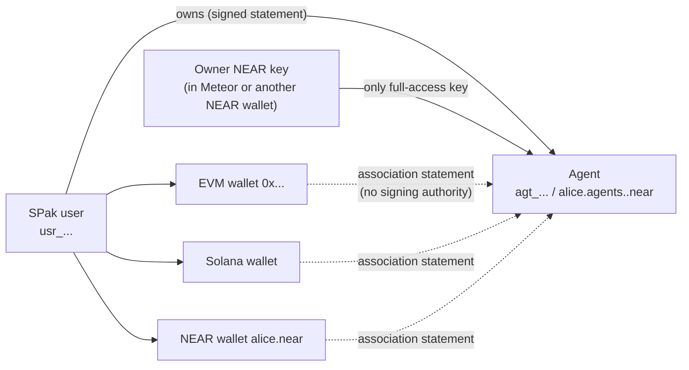
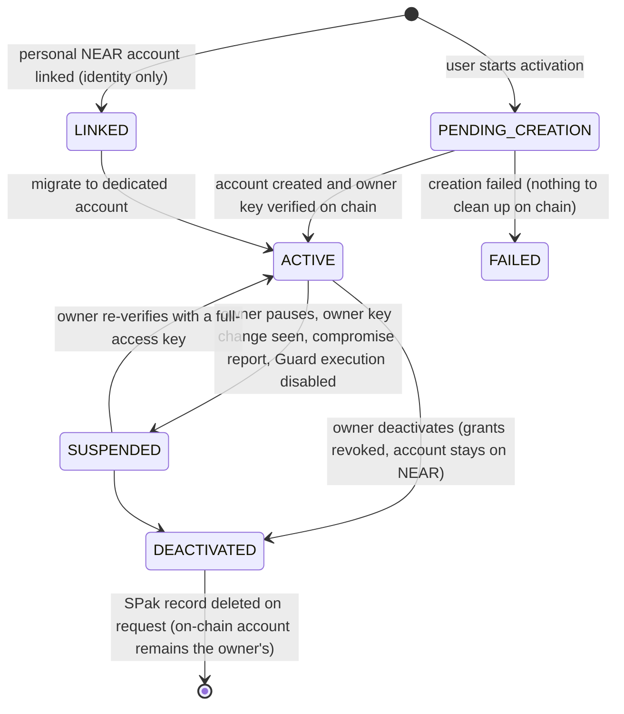

# SPak Agent identity model

Status: proposal for review.

## 1. What identifies a SPak Agent

A SPak Agent is a **NEAR account dedicated to SPak use**, bound to one SPak user (the owner).

- Its permanent identifier is the NEAR account id, for example `alice.agents.<spak-parent>.near`.
- Internally it also has a SPak id (`agt_...`) so records survive an identity migration.
- Its authority comes only from keys the owner holds and grants the owner signs. Creating the account grants no authority over any other wallet.

## 2. Verified NEAR capabilities

Each row: verified fact, source, limitation, and what it means for SPak. Pages were read on 2026-11-13.

| Capability | Verified fact | Source | Limitation | SPak implication |
|---|---|---|---|---|
| Account types | Named (`alice.near`), implicit (64 hex), Ethereum-like (`0x...`), deterministic (`0s...`) and universal (`0u...`) account ids exist | docs.near.org/protocol/accounts-contracts/account-id.md | Implicit accounts must be funded (can be 0 NEAR) before they sign | A named account gives the Agent a readable, stable identity |
| Sub-accounts | "Accounts cannot create sub-accounts of other accounts." Only `parent.near` creates `x.parent.near`. "Accounts have no control over their sub-account" | same | SPak must own a parent account to issue names under it | Agent names live under a SPak-owned parent. The parent has no control over them after creation |
| Full-access keys | Can transfer NEAR, delete the account, create sub-accounts, add or remove keys, deploy contracts, call any contract | docs.near.org/protocol/access-keys | Anyone with one controls the account | Only the owner holds full-access keys. SPak never does |
| Function-call keys | Can call only `receiver_id`, optionally only listed methods; "do not allow to attach NEAR tokens"; optional gas allowance that cannot be changed later | same | Allowance exhausted means the key is unusable; a new key is needed | The only key type SPak could ever hold, and only for a SPak-controlled agent contract, in a future stage |
| Key management | Adding a key needs a full-access key or a method in the account's own contract | same | Removing all keys locks the account | Key changes are owner actions, signed in the owner's wallet |
| Recovery | No protocol-level or social recovery is described. Losing the only full-access key locks funds "forever". Backup keys are the documented mitigation | docs.near.org/protocol/network/token-loss.md | Recovery depends on the user keeping a second key | SPak cannot promise recovery. It can prompt for a backup key |
| Meta-transactions | NEP-366: user signs a `DelegateAction`, a relayer pays gas. One receiver per meta-transaction; the sender account must exist | docs.near.org/protocol/transactions/meta-tx.md | No atomicity across receivers | SPak can pay gas for owner-signed Agent setup actions without holding keys |
| NEAR Intents identity | Verifier identifies users by NEAR account id. "Users do not need to create a NEAR account to use NEAR Intents." Named accounts register keys with `add_public_key` and remove them with `remove_public_key` | docs.near-intents.org/integration/verifier-contract/account-abstraction.md | "Each key has full control and can add or remove other keys" | Never register an external wallet key on the Agent's Verifier account by default: it would get full control of that balance |
| Intent signing | Verifier accepts `nep413`, `erc191`, `tip191`, `raw_ed25519`, `webauthn`, `ton_connect`, `sep53` | .../signing-intents.md | No delegation or session keys documented | Future Agent-held Verifier balances need their own key policy |
| 1Click | Deposit-address flow: quote, user deposits, status polling. "1Click does not take custody" | .../1click-api/about-1click-api.md | Partner JWT needed for normal fees | Manual Access keeps working without NEAR accounts |
| Chain Signatures | `v1.signer` (mainnet), `v1.signer-prod.testnet`. `sign(payload, path, domain_id)` with Secp256k1 or Ed25519. Address derived from the calling NEAR account, the path and the MPC key; MPC nodes, none signs alone | docs.near.org/chain-abstraction/chain-signatures, .../implementation | Outbound signing only. No documented way to control an existing external key. Fees, latency and threshold values not documented on these pages | Future Agent-derived addresses only. Never a way to act for a user's MetaMask or Phantom wallet |

Not verified (assumptions to check before building): account creation storage cost; which parent account SPak can own (`spak.near` availability); Chain Signatures deposit per call; MPC latency.

## 3. Account models compared

| Model | How it works | Meaningful NEAR identity | User keeps control | SPak custody risk | Verdict |
|---|---|---|---|---|---|
| A. Link a personal NEAR wallet (today) | User's existing `alice.near` is labelled the Agent | Weak: it is the user's personal account | Yes | None | Keep only as a transitional, identity-only option |
| B. SPak-held implicit account | SPak generates and stores a key | Yes | No | Custodial: SPak holds keys | Rejected. Violates "no private keys" |
| C. Dedicated named Agent account, owner-keyed (recommended) | SPak's factory creates `name.agents.<parent>.near` in one transaction with the owner's public key as the only full-access key | Yes: a separate account for SPak use | Yes | None: SPak never has a key on it | Recommended |
| D. Agent contract account | Model C plus an agent contract deployed by the owner with on-chain limits | Strongest | Yes | Low, if the contract is reviewed | Future, required before autonomy |
| E. Implicit account from a key the user generates | Account id is the hex of the user's public key | Yes, but unreadable | Yes | None | Allowed fallback if the named parent is not available |

### Recommendation: model C now, model D before autonomy

- **Why C.** It gives the Agent its own NEAR account, separate from the user's personal funds, with a readable name and on-chain history. The owner's wallet holds the only full-access key from the first block, so SPak never had custody. It works with NEP-366 so SPak can pay creation gas.
- **Why not A as the target.** A personal account mixes the user's savings with Agent activity, and any future function-call key or contract would sit on their main account.
- **How C is created.** The factory contract on the SPak parent account calls `CreateAccount`, `AddKey(owner public key, full access)` and `Transfer(initial storage deposit)` as one batch. The factory adds no key of its own. SPak verifies on chain afterwards that the only full-access key is the owner's.

## 4. Owner binding

- The owner proves control of the Agent by signing a NEP-413 message with a full-access key of the Agent account. SPak checks the key is currently a full-access key on chain (RPC `view_access_key`).
- Ownership is re-checked on chain at grant time and periodically. If the owner key is removed on chain, the Agent is suspended.

## 5. Questions answered

| Question | Answer |
|---|---|
| Does every user get a NEAR account? | No. Only users who activate SPak Agent. Manual Access users never need one |
| Existing NEAR account connected? | It can be the owner key holder (its key becomes the Agent's full-access key), or a linked identity-only Agent (model A). It is never silently converted |
| Activate without disconnecting wallets? | Yes. Wallets are associated, not replaced |
| Multiple wallets per Agent? | Yes, any number, each with its own signed association, per family and network |
| Multiple Agents per user? | Data model allows it (`spak_agents` has no unique owner constraint). The first release limits it to one; the UI and permissions are per Agent from day one |
| Internal representation | `agt_` id, NEAR account id, owner user id, creation method, status, key snapshot, version counter |

## 6. Wallet association

Association answers "this wallet belongs to the same person as this Agent". It never lets the Agent sign for the wallet.

1. The wallet is already verified in `spak_wallets` (existing challenge flow).
2. SPak builds a statement: app domain, user id, Agent NEAR account id, wallet address and family, purpose `AGENT_ASSOCIATION`, nonce, issued-at, expiry.
3. The wallet signs it with its native standard (EIP-4361 style, SIWS style, NEP-413). The server verifies against its own stored copy, consumes the nonce once, and stores signature and statement.
4. Associations expire (proposal: 180 days) and must be re-signed. An expired association is ignored, not deleted.

| Event | Effect |
|---|---|
| Wallet removed by the user | Association revoked immediately. Pending executions that need it stop at the next Guard stage. Logged |
| Wallet reported compromised | Association revoked, wallet blocked from re-association for that user until confirmed, all Agent grants paused, user notified |
| Same address claimed by another user | Refused: `(family, address)` is unique across users today and stays so |
| Multiple wallets on one network | Allowed. Each grant names which wallet it may use |

## 7. Lifecycle

| Action | Who | Needs |
|---|---|---|
| Create | Owner | Owner wallet signature (NEP-413 on the request, then the public key for the factory) |
| Activate | Owner | On-chain check that the owner key is the only full-access key |
| Suspend | Owner or SPak (automatic on risk signals) | Session for owner. Automatic suspension needs no signature, because it only removes authority |
| Resume | Owner | Fresh NEP-413 signature from a current full-access key |
| Associate or remove a wallet | Owner | Association: that wallet's signature. Removal: session only |
| Grant or widen permissions | Owner | NEP-413 signature from the Agent's full-access key over the exact grant |
| Revoke or narrow permissions | Owner | Session only. Taking authority away must never wait for a signature |
| Recover | Owner | Only through a backup full-access key the owner added. SPak cannot recover a lost key |
| Migrate identity | Owner | Signatures from both the old and new accounts |
| Delete | Owner | Session plus confirmation. Deletes SPak records; the NEAR account stays under the owner's keys |
