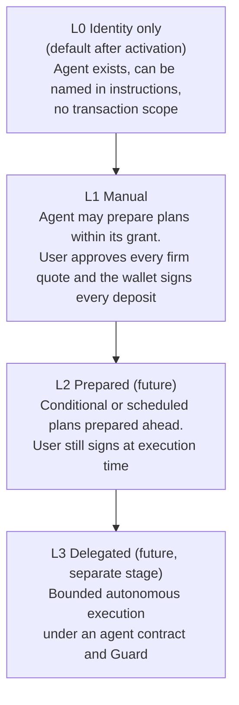
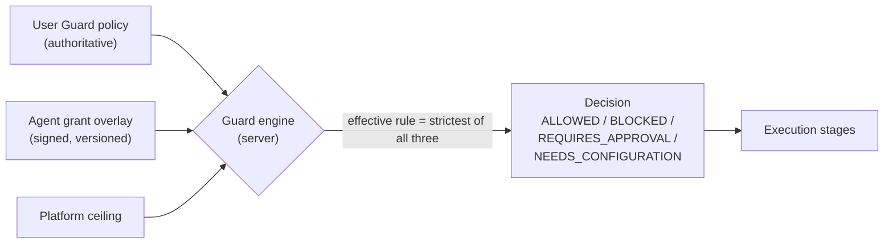

# SPak Agent permissions

Status: proposal for review.

## 1. Permission domains

| Domain | Examples | Held by | Granted by | Revoked by |
|---|---|---|---|---|
| Identity | Who the Agent is, owner binding, Agent name | Owner (full-access key) | Account creation | Owner key change on chain |
| Wallet | Which wallets are associated, which may be used per network | Each wallet's own key | That wallet's signature | Owner session, wallet removal |
| Transaction | Which transfers the Agent may prepare, for which assets, networks, recipients, amounts | Agent grant, inside Guard | Owner NEP-413 signature over the grant | Owner session, expiry, Guard pause |
| Automation (future) | Conditional or scheduled execution, autonomous execution | Agent grant plus agent contract | Owner signature, opt-in per capability | Owner session, expiry, emergency stop |
| Administrative | Suspension, deletion, support review | Owner; SPak operations only for safety actions that remove authority | Role, audited | n/a |

## 2. Levels



- New Agents start at L0. Moving up always needs an owner signature over the exact grant. Nothing moves up on its own.
- L1 adds no signing power. It is the same manual flow with the Agent's grant applied on top of Guard.
- L3 is described only so later stages do not need to rebuild the model. It is not part of this architecture's first stages.

## 3. A grant

A grant is a signed, versioned, expiring statement. Proposed shape:

```json
{
  "agent": "alice.agents.<spak-parent>.near",
  "version": 3,
  "level": "L1",
  "validFrom": "2026-11-20T00:00:00Z",
  "validUntil": "2027-02-20T00:00:00Z",
  "scope": {
    "maxTransactionUsd": "200",
    "dailyLimitUsd": "500",
    "networks": { "base": ["source"], "solana": ["destination"] },
    "assets": ["base:0x8335...2913", "solana:native"],
    "recipients": [{ "network": "solana", "address": "9WzD..." }],
    "wallets": ["wlt_..."],
    "intentTypes": ["CROSS_CHAIN_SWAP"]
  },
  "nonce": "...",
  "domain": "usespak.vercel.app"
}
```

- Signed with NEP-413 by a full-access key of the Agent account, verified on the server and against chain state.
- Stored with signature, signer key and statement. The server never accepts a grant without a valid signature.
- One active grant per Agent at a time. A new version replaces the old one; history is kept.
- Narrowing (lower limits, fewer assets, earlier expiry) and revocation need only an authenticated session. Widening needs a new signature.

## 4. Guard integration

Guard stays the authority. The grant is an **overlay that can only narrow** the user's Guard policy.



| Question | Answer |
|---|---|
| Extend Guard or separate layer? | A separate, stored overlay evaluated inside the same Guard engine as extra rules. One engine, one decision, one audit trail |
| Can Agent rules be stricter? | Yes, always. They can never be looser: limits use the minimum, allowlists use the intersection, blocks use the union |
| Conflicts | Strictest wins. A grant that is broader than Guard is not an error; the excess is simply never usable |
| Missing or expired grant in Agent mode | `NEEDS_CONFIGURATION` (or `BLOCKED` when revoked). Never fall back to user-level permissions silently |
| Policy changes and pending work | Every stage re-reads the latest policy and grant. Approval binds the decision to policy version and grant version. Future scheduled jobs re-evaluate at trigger time |
| Revocation | Immediate. Executions not yet approved are blocked at their next stage. Approved executions continue through tracking and recovery, exactly like Guard pause today |
| Bypass prevention | The grant check runs inside `GuardService`, which execution and deposits already require. The approval transaction records the grant version with the reservation. Agent mode without a grant cannot pass Guard |

Engine change needed (future stage): `evaluateGuard` takes an optional overlay, adds rules such as `AGENT_GRANT_ACTIVE`, `AGENT_WALLET_ALLOWED`, `AGENT_INTENT_TYPE`, and reports them like any other rule.

## 5. Who holds what

| Holder | Holds | Does not hold |
|---|---|---|
| User | All private keys: external wallets, Agent full-access key, backup key | |
| SPak servers | Grants, signatures, policies, audit logs, sessions | Any private key or seed phrase; any full-access key on an Agent account |
| Guard | Decisions and reservations | Signing ability |
| NEAR Intents | Settlement, deposit addresses | User identity in Manual Access |
| Agent contract (future) | On-chain limits, the right to call `v1.signer` for Agent-derived addresses | Authority over external wallets |
| SPak function-call key (future, L3 only) | Permission to call the Agent contract's limited methods | Ability to attach NEAR, transfer, change keys |

## 6. Audit

Every grant, narrowing, revocation, association, suspension and key change writes an `spak_agent_events` row with actor, before and after, signature reference and time. Guard decisions in Agent mode record the grant version next to the policy version.

## 7. Future autonomous execution: requirements

All must be true before L3 ships. None is built now.

1. Explicit opt-in per Agent, per capability, signed by the owner.
2. Grant limits: per-transfer, daily, weekly, monthly, allowed assets and networks, approved recipients only, allowed intent types.
3. Hard expiry (proposal: 30 days maximum) and immediate revocation.
4. An agent contract enforcing limits on chain, so a SPak server compromise cannot exceed them.
5. Transaction-level authorisation: each autonomous transfer gets its own Guard decision and reservation, logged before signing.
6. Execution logs the owner can read, plus notifications for every autonomous transfer.
7. Emergency stop: Guard "disable all execution" stops autonomous signing too, and the owner can delete the SPak function-call key on chain without SPak's help.
8. No self-expansion: a grant can only be widened by a new owner signature. The Agent cannot sign grants.
9. Independent security review of the contract and signing path.

## 8. Preconditions for any future grant (from the hardening stage)

A future permission grant must require, at grant time and at use time: Agent ownership current, dedicated account ACTIVE with fresh evidence (exact owner key only), and each wallet it names ACTIVE by its own fresh proof (`associationUsable()`). A suspended, expired or recovery-required component blocks the grant. None of this exists yet.
