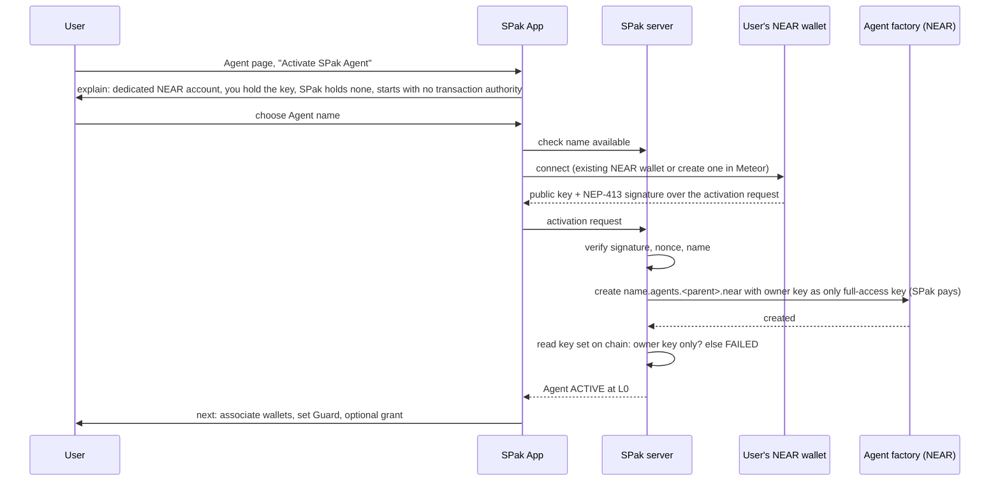
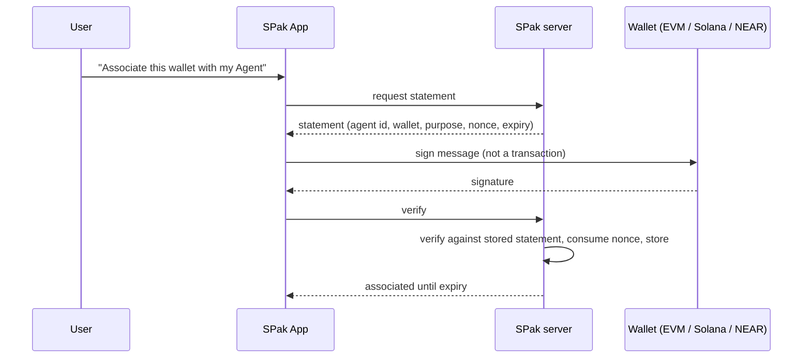

# SPak Agent user flows

Status: proposal for review. Manual Access stays exactly as it is today.

## 1. When can a user start

| User | Can use SPak | Needs for SPak Agent |
|---|---|---|
| Has an EVM or Solana wallet only | Immediately, Manual Access | A NEAR wallet to hold the Agent owner key |
| Has a NEAR wallet | Immediately, Manual Access | Activation (one signature, SPak pays creation) |
| New to crypto | After connecting any supported wallet | A NEAR wallet, then activation |

## 2. Entry point 1: existing wallet user activates SPak Agent

## 3. Entry point 2: new user

1. Connect any supported wallet and sign in (existing flow). Manual Access is ready.
2. Optional: "Set up SPak Agent". If no NEAR wallet, SPak explains what one is and links to a supported wallet.
3. Continue with entry point 1 from "choose Agent name".

## 4. Wallet association

## 5. Permission setup (L1)

1. User opens "Agent permissions". The current Guard policy is shown as the outer limit.
2. User picks scope: networks, assets, recipients, wallets, limits, expiry. Anything wider than Guard is shown as "limited by Guard".
3. SPak shows the exact grant text. The NEAR wallet signs it (NEP-413).
4. Server verifies the signature and that the signing key is a current full-access key on chain. The grant becomes active with a version number.

## 6. Suspension and resume

- Owner: "Pause Agent" (session only). Takes effect immediately. Approved transfers continue through tracking and recovery.
- Automatic: owner key change seen on chain, compromise report, Guard disable-all.
- Resume: a fresh NEP-413 signature from a current full-access key.

## 7. Recovery

- The app shows, during activation, a prompt to add a backup full-access key in the user's NEAR wallet, and states plainly that SPak cannot recover the account without it.
- Owner key rotated on chain: the Agent suspends, the user re-verifies with the new key.
- No key left: the Agent is deactivated in SPak; a new Agent can be created.

## 8. Deactivation and deletion

- Deactivate: grants revoked, associations kept as history, NEAR account untouched.
- Delete: SPak records removed after confirmation; on-chain account remains with the owner.
