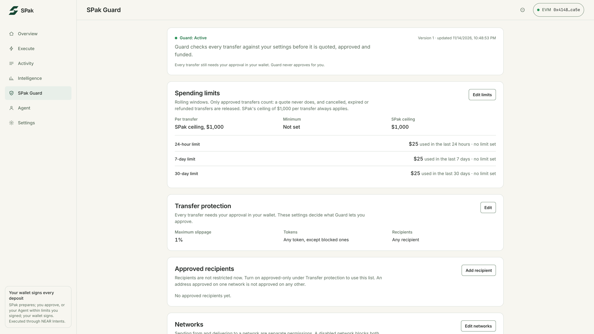

# SPak Guard

Your own policy for every transfer.

- Per-transfer spend limit
- Daily spend limit
- Allowed networks
- Allowed assets
- Allowed recipients

Guard runs before the quote and again before the deposit. If a check cannot run, the transfer stops.

*Guard settings (preview build).*

Detail: [SPAK-GUARD-ARCHITECTURE.md](SPAK-GUARD-ARCHITECTURE.md), [SPAK-GUARD-POLICY-MODEL.md](SPAK-GUARD-POLICY-MODEL.md), [SPAK-GUARD-SECURITY.md](SPAK-GUARD-SECURITY.md).
