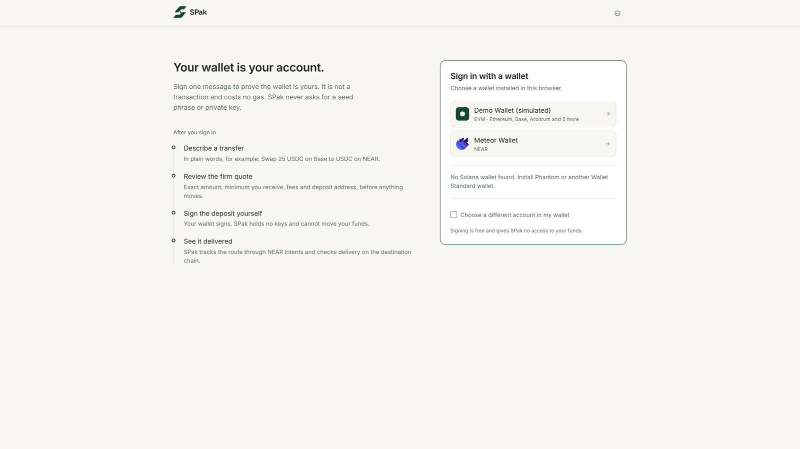
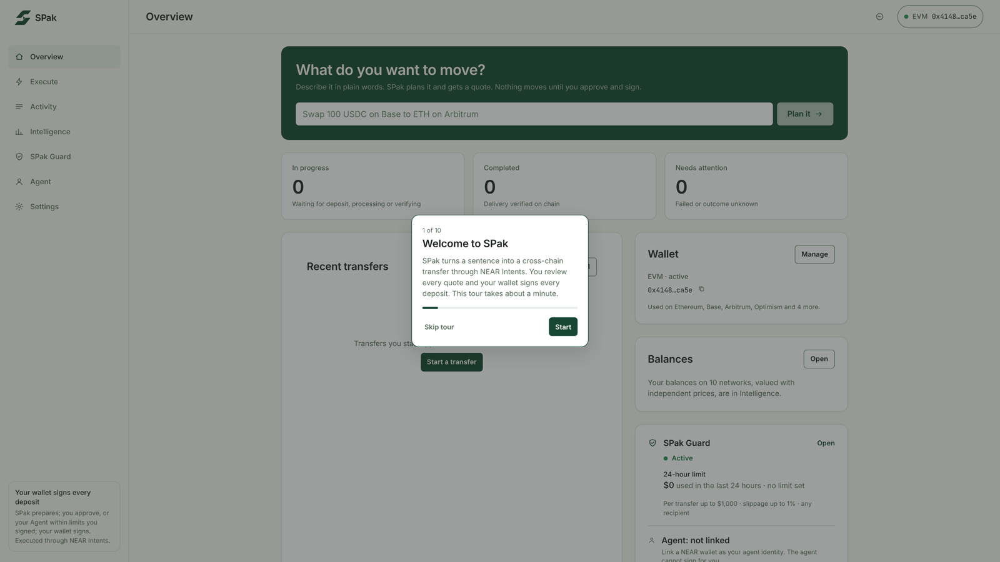
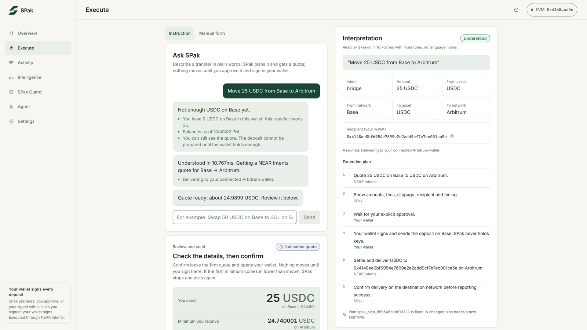
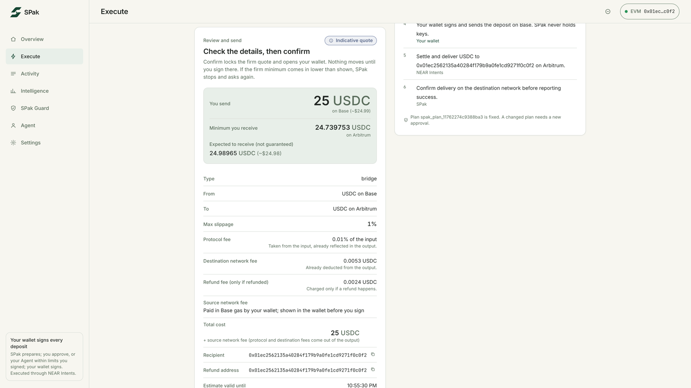
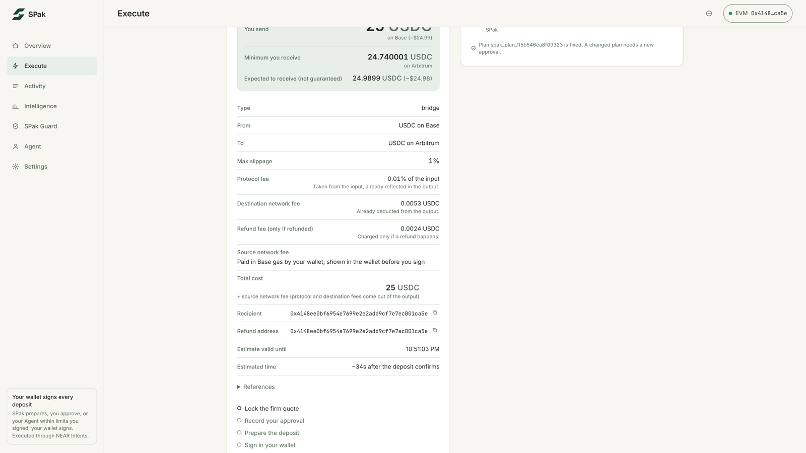
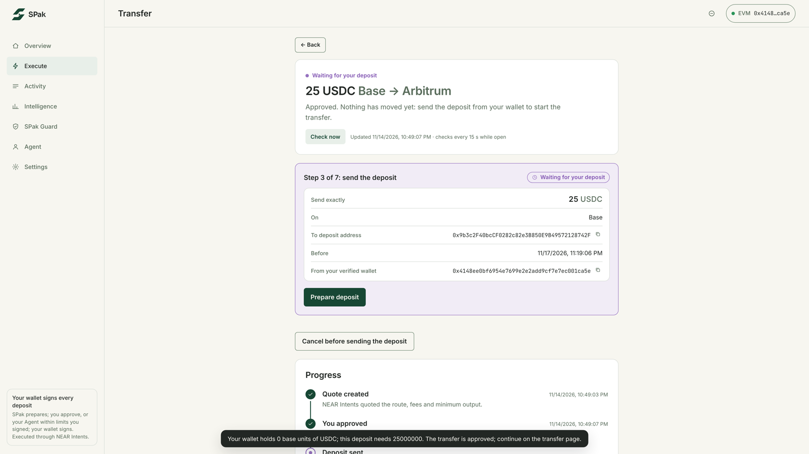

# How SPak works

1. Sign in with a wallet. SPak sends a challenge; your wallet signs it; the server verifies the signature.
2. Type an instruction, for example "Move 20 USDC from Base to NEAR".
3. SPak-in builds a plan: action, amount, source asset, destination asset, recipient. If anything is ambiguous, it asks.
4. SPak Intelligence reads your balance on the source network. A shortfall shows as a warning before the quote.
5. SPak Guard checks your limits.
6. SPak requests a NEAR Intents quote, checks its signature and shows the review.
7. You press "Confirm and send". SPak then:
   - fetches a firm quote and stops if its minimum is below the one you saw,
   - records your approval bound to the plan hash,
   - asks your wallet for any token approval,
   - builds the deposit and asks your wallet to sign it.
8. SPak verifies the deposit on the source chain.
9. NEAR Intents settles. SPak checks the destination chain for the payout from a trusted sender.
10. The transfer shows Complete, Refunded or Manual review. Nothing shows as complete before that check.

*Wallet sign-in.*

*First-run tour.*

*Instruction interpreted, balance flagged.*

*Review from a signed quote.*

*Confirm progress.*

*Tracking until verified delivery.*

All app captures come from a preview build with a simulated, empty wallet. No funds moved.

Deeper detail: [SPAK-DEPOSIT-FLOW.md](SPAK-DEPOSIT-FLOW.md), [SPAK-TRACKING.md](SPAK-TRACKING.md), [SPAK-FAILURE-REFUNDS.md](SPAK-FAILURE-REFUNDS.md).
