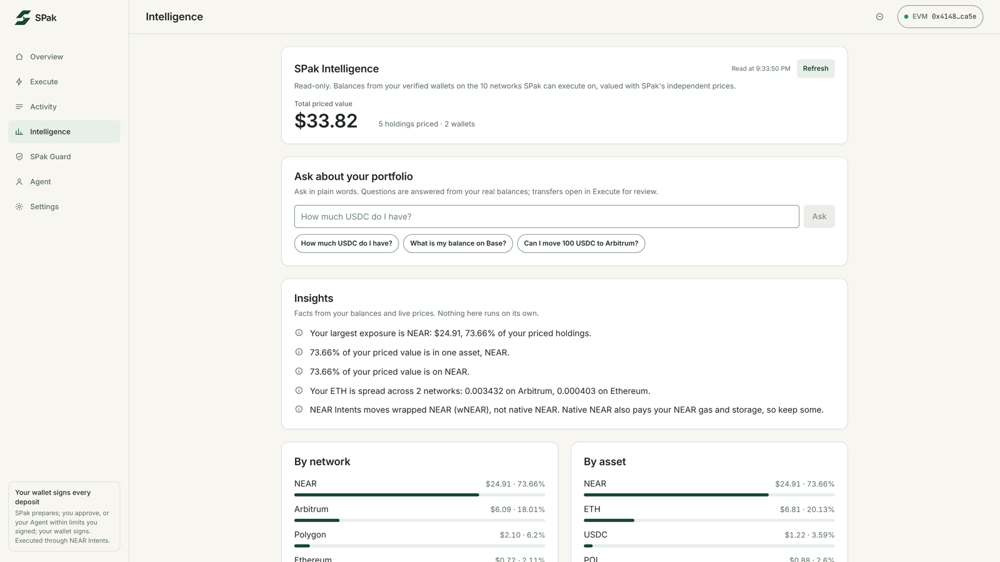
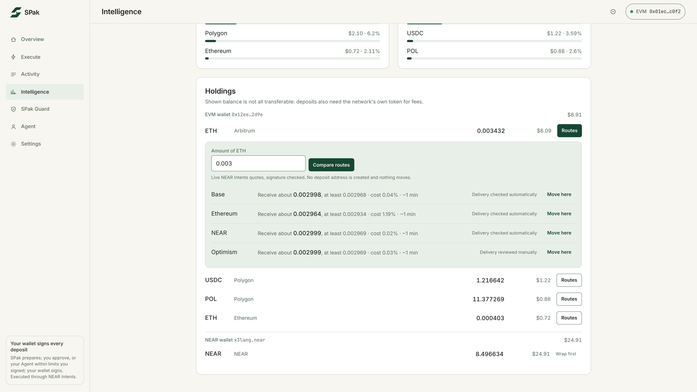

# SPak Intelligence

A read-only layer that knows what you hold. It never signs and never moves funds.

## What it does

- Reads balances directly from chain RPCs for your linked wallets on 10 networks.
- Reports an unreadable balance as unknown, never as zero.
- Reads native NEAR and prices it through wNEAR.
- Prices assets with Chainlink first. CoinGecko is used only when it agrees with the provider price.
- Caches a snapshot for 60 seconds.
- Adds context to chat answers: portfolio answers, feasibility of a plan, source options, or a plain "unavailable".
- Shows concentration and largest-exposure insights.
- Compares live NEAR Intents routes for a holding. Quotes are real and signature-checked. Nothing moves.

*Portfolio view. Data: live read of public mainnet wallets, because the demo wallet is empty.*

*Live route comparison.*

## Limits

- Balance checks warn; they do not block a quote.
- Portfolio-aware intents beyond balance checks are in progress.
