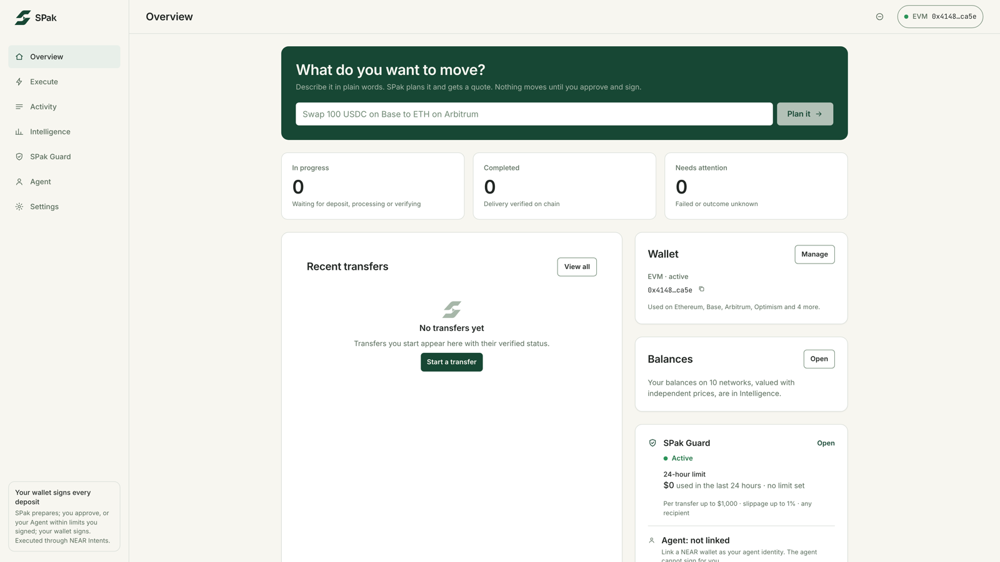
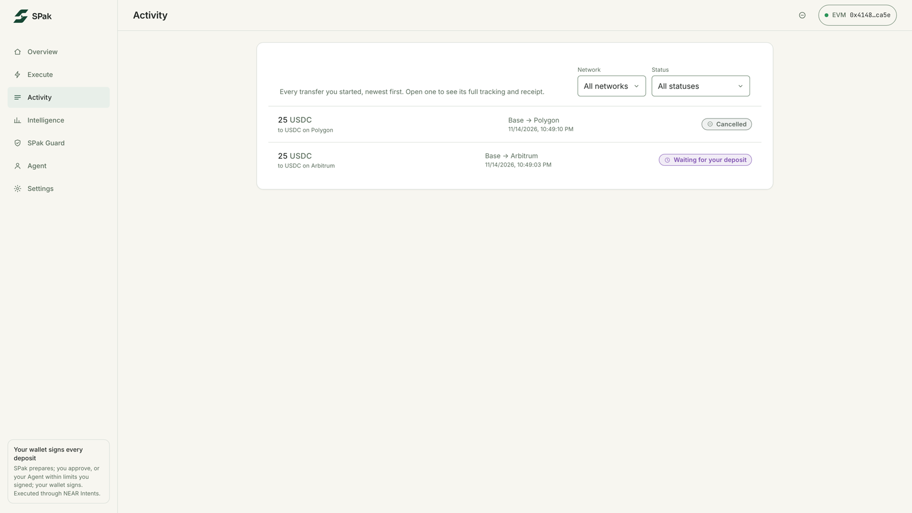
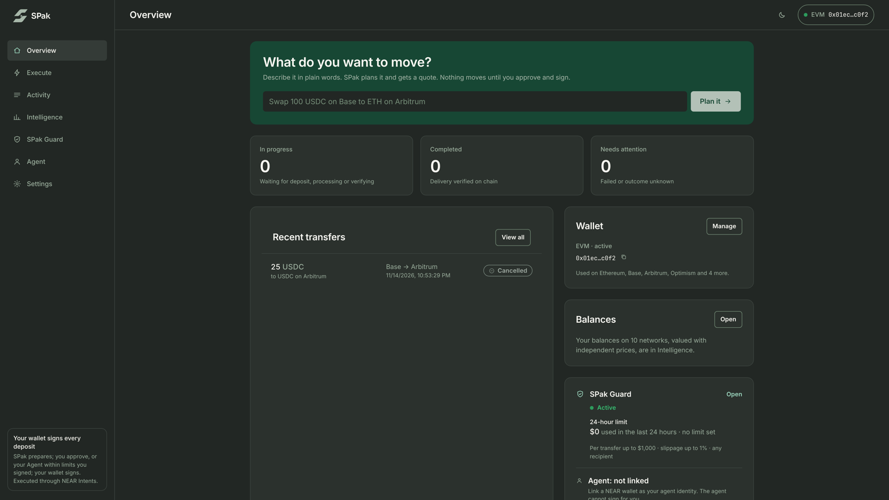

# SPak product overview

SPak turns a plain-language instruction into a cross-chain transfer through NEAR Intents. You review every quote. Your wallet signs every deposit. SPak marks a transfer complete only after the destination chain confirms delivery.

## Who it is for

You hold assets on more than one chain and want to move them without choosing bridges, copying deposit addresses or checking explorers by hand.

## Classification

Live means in the code, tested and running in production at usespak.vercel.app. Built means tested in the repository but not deployed yet. Partial means part of the feature exists. Upcoming means planned and not built.

| Feature | Status | Notes |
|---|---|---|
| Website | Live | usespak.vercel.app |
| Wallet sign-in (EVM, Solana, NEAR) | Live | Signature verified on the server |
| SPak-in instruction parser | Live | Deterministic, no language model |
| Signed NEAR Intents quotes | Live | Quote signature checked |
| Review screen | Live | Amounts, minimum received, fees, recipient |
| One-click confirm | Built | Firm quote, approval and deposit in one confirm |
| NEAR recipient registration fix | Built | 1Click registers the recipient and charges the quoted withdrawFee |
| Delivery verification | Live | 45 of 90 USDC routes automatic; others flagged for manual review up front |
| Refund tracking | Live | |
| SPak Guard | Live | Limits, allowed networks, assets, recipients |
| SPak Intelligence | Live | Read-only balances and prices on 10 networks |
| Guided tour | Built | First-run tour, replayable from the account menu |
| SPak Agent identity | Partial | Agents cannot move funds |
| Verified mainnet settlement | In progress | No verified SPak mainnet settlement yet |
| Conditional and scheduled execution | Upcoming | Parsed by SPak-in, not executed |
| Advanced Agents, developer APIs, rebalancing | Upcoming | |

## Screens

| Screen | Purpose |
|---|---|
| Overview | Recent transfers and a start point |
| Execute | Chat, review and confirm |
| Activity | Every transfer with live status |
| Intelligence | Portfolio, insights, route comparison |
| Guard | Your limits |
| Agent | Agent identity setup |
| Settings | Linked wallets and networks |

*Overview screen (preview build, simulated wallet).*

*Activity screen.*

*Overview in the dark theme.*
